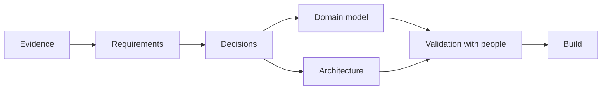

# Cartograph design

Cartograph helps people write down what they have decided to do and why, and steer it: from a hobbyist's group to a national government, from a single idea to a portfolio of programmes. This repository holds its design: the requirements, the evidence they rest on, the domain model, the architecture, and the decisions that shape them.

The design is reviewed and approved here before the new build starts. The exploratory implementation in [cartograph-engine](https://github.com/ProjectCartograph/cartograph-engine) and [cartograph-ui](https://github.com/ProjectCartograph/cartograph-ui) informs it; the build starts from the requirements.

## The design in brief

- **One record for work at any scale.** A project, a programme, a portfolio and a service are one kind of record with a label, not separate forms.
- **People start from the change they want.** The first questions are what is wrong, what should be different and for whom; the kind of work is suggested afterwards.
- **The case grows, and every step is a decision.** One justification becomes more complete through the work's life, and each step ends in a recorded decision, which may be to stop.
- **The work continues after delivery.** Benefits are accepted by an owner and tracked until a review says whether they arrived.
- **Domains configure; they do not fork.** A profile holds the taxonomy, life cycles, cycles, deciding roles and calendars; methods are extensions.
- **Programmes run in tranches; ongoing work runs in cycles.** A programme commits to delivery and opens each tranche by its own decision; work without an end is steered by cycles, each period ending in a decision.
- **One truth, many views.** A charter, a business case, a logical framework and an open data file are views of the same record.
- **Records live with the people who keep them.** They work offline on any device, are encrypted before they leave it, keep every version, and change only through proposals a person accepts.

## Reading it

The documentation follows [Diataxis](https://diataxis.fr/): each page does one of four jobs.

| To | Read |
|---|---|
| Learn the design by following one thread through it | [Read the design](docs/tutorials/read-the-design.md) |
| Review a requirement, propose a decision, trace a requirement, add evidence | [How-to guides](docs/how-to/review-a-requirement.md) |
| Look up a requirement, a decision, a term, a source or a record | [Requirements](docs/reference/requirements/README.md), [decision log](docs/reference/decision-log.md), [glossary](docs/reference/glossary.md), [bibliography](docs/reference/bibliography.md), [domain catalogue](docs/reference/domain-catalogue.md), [existing components](docs/reference/existing-components.md), [design process](docs/reference/design-process.md) |
| Understand the reasoning and the trade-offs | [Vision and scope](docs/explanation/vision-and-scope.md), [the evidence](docs/explanation/the-evidence.md), [design principles](docs/explanation/design-principles.md), [why a new model](docs/explanation/why-a-new-model.md), [the domain model](docs/explanation/domain-model.md), [the architecture](docs/explanation/architecture.md) |

## Status

The research (M1), the requirements (M2, with all 94 approved) and the domain model (M3) are complete. The architecture decisions (M4) are under review, and the change-first entry is tested with people next (M5). The [design process](docs/reference/design-process.md) shows the milestones and what each status means.

## Contributing

Nix is the toolchain: `just test` checks every link, identifier, citation, word and diagram. See [CONTRIBUTING.md](CONTRIBUTING.md).

## Licence

[Creative Commons Attribution 4.0](LICENSE).
