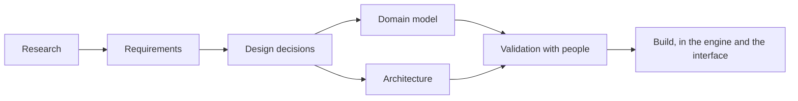

# Cartograph design

The requirements, research, domain model, architecture and design decisions for Cartograph, a tool for writing down what an organisation has decided to do and why, and steering it, at any scale from a hobbyist's group to a national government.

This repository is where the design is reasoned out, reviewed and approved before the code in [cartograph-engine](https://github.com/ProjectCartograph/cartograph-engine) and [cartograph-ui](https://github.com/ProjectCartograph/cartograph-ui) changes ([DD-0003](docs/explanation/decisions/DD-0003-design-approved-before-the-code-changes.md)). Everything Cartograph has released so far is an exploratory phase ([DD-0002](docs/explanation/decisions/DD-0002-exploratory-releases-carry-no-promise.md)); the design here is a new model, reusing only what earns its place ([DD-0001](docs/explanation/decisions/DD-0001-a-new-model-reusing-only-what-earns-its-place.md)).

## Where things stand

The research is done and the design is proposed. Next, the requirements are reviewed and approved ([milestones](docs/reference/milestones.md)).

## Reading it

The documents follow [Diataxis](https://diataxis.fr/): each page does one of four jobs.

| If you want to | Read |
|---|---|
| Learn the design by following one thread through it | [Tutorial: review the design](docs/tutorials/review-the-design.md) |
| Review a requirement, propose a decision, trace a requirement or add a source | [How-to guides](docs/how-to/) |
| Look up a requirement, a decision, a term, a source or a record | [Requirements](docs/reference/requirements/README.md), [decision log](docs/reference/decision-log.md), [glossary](docs/reference/glossary.md), [sources](docs/reference/sources.md), [domain catalogue](docs/reference/domain-catalogue.md), [reuse candidates](docs/reference/reuse-candidates.md), [milestones](docs/reference/milestones.md) |
| Understand the problem, the reasoning and the trade-offs | [The problem](docs/explanation/the-problem.md), [why a new model](docs/explanation/why-a-new-model.md), [how the research was done](docs/explanation/how-the-research-was-done.md), [the domain model](docs/explanation/domain-model.md), [the architecture](docs/explanation/architecture.md), [the decisions](docs/reference/decision-log.md) |

The evidence is in [research](research/README.md): three rounds of reports, with the briefs that directed them.

## Working on it

Nix is the toolchain. `just test` checks every link, identifier, word and diagram; `just ci` is what CI runs. See [CONTRIBUTING.md](CONTRIBUTING.md) and [AGENTS.md](AGENTS.md).

## Licence

The documents are licensed under [Creative Commons Attribution 4.0](LICENSE). The research reports summarise and cite their sources, which keep their own licences.
