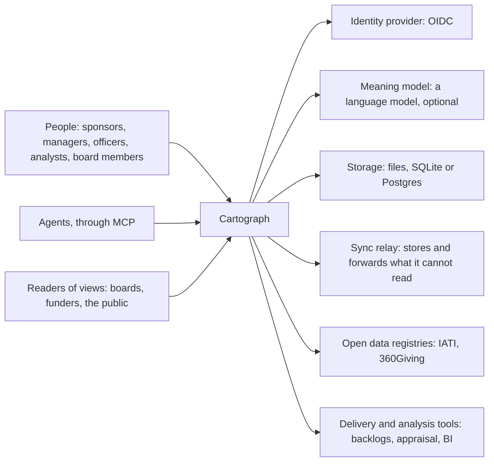
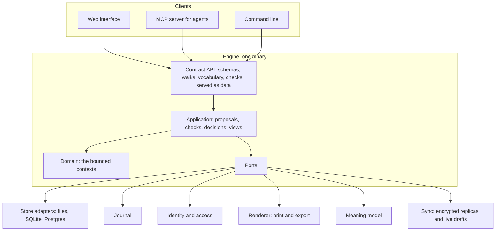
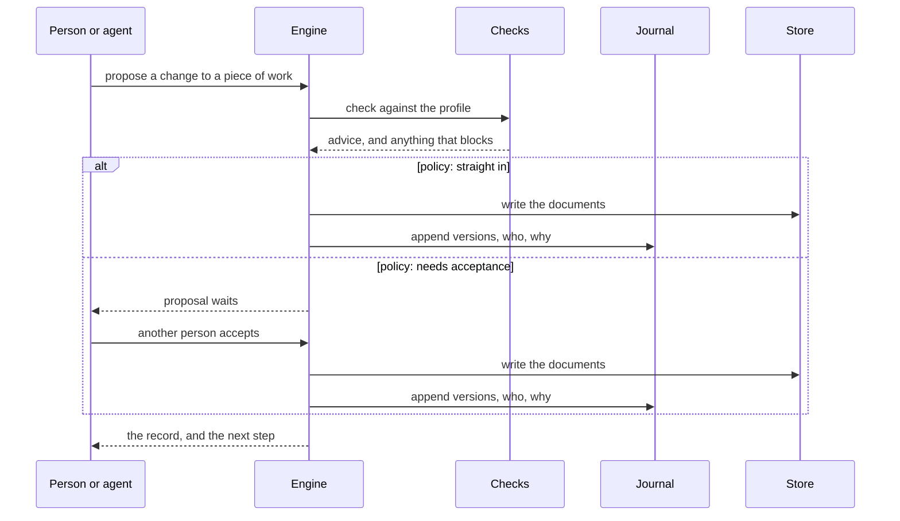

# The architecture

This page explains the shape of the system at a level above the code: what Cartograph talks to, what it is made of, how a change flows through it, and the trade-offs behind each choice. Which parts of the exploratory implementation may be reused is judged in [existing components](../reference/existing-components.md).

## What Cartograph talks to

Cartograph holds the case, the decisions and the results. It links to delivery tools (a backlog, a schedule, a building model) and to analysis tools (an appraisal, a data warehouse), and holds their results, never their workings ([DD-0009](decisions/DD-0009-a-small-core-with-extensions.md)).

## What it is made of

The engine is one program, from a single person's laptop to a national deployment. The dependencies point inward: the domain knows nothing of adapters, and each adapter passes a conformance suite.

| Choice | Chosen | Instead of | Because | At the cost of |
|---|---|---|---|---|
| Contract as data | Schemas, walks, vocabulary and checks served by the engine | Each interface hard-coding the model | One definition for every interface and agent ([K1](../reference/requirements/platform.md#k1-the-contract-as-data)); profiles change the served data, not the code | A generic interface is harder to make beautiful than a bespoke one |
| One program | A modular monolith with a module per context | Services per context | Runs anywhere from a laptop to a cluster; contexts stay separate by architecture tests, not by networks | Scaling is of the whole, not of a part |
| Ports and adapters | Storage, identity, rendering, meaning and sync behind ports | Direct dependencies | Files for a hobbyist, Postgres for a nation ([K2](../reference/requirements/platform.md#k2-from-files-to-a-shared-database)); each swappable | An interface to keep per port |
| Documents and a journal | Plain documents as the truth, an append-only journal of versions | Event sourcing; git | Readable files ([O1](../reference/requirements/openness-and-exchange.md#o1-plain-open-files-both-ways)) with durable history ([K4](../reference/requirements/platform.md#k4-durable-history)) ([DD-0011](decisions/DD-0011-documents-with-an-append-only-journal.md)) | Two structures to keep consistent |
| Proposals for every write | One route for people and agents, with a per-workspace policy | Direct writes | Review where needed, none where not ([K3](../reference/requirements/platform.md#k3-versioned-change-reviewed-where-the-policy-asks)); agents never write ([K5](../reference/requirements/platform.md#k5-agents-propose-people-decide)) | A concept every person meets, made light by the straight-in policy |
| Local-first replicas | Encrypted replicas on people's devices, live editing inside drafts, a relay that holds only ciphertext ([DD-0018](decisions/DD-0018-live-co-editing-in-drafts.md)) | A central server holding the truth | Offline work on any device, and a host that cannot read the records ([K8](../reference/requirements/platform.md#k8-local-first), [K9](../reference/requirements/platform.md#k9-live-and-private-drafts), [K10](../reference/requirements/platform.md#k10-encrypted-by-default)) | Checks and search run on devices; removing a person cannot take back what they already held |

## How a change flows

A decision follows the same route, and names the journal version of the case it rests on. Under local-first work the checks run on the device that proposes a change and again on the device that accepts it, from the contract the engine serves as data, and the relay only carries signed, encrypted changes between replicas ([DD-0018](decisions/DD-0018-live-co-editing-in-drafts.md)).

## Quality attributes

| Attribute | What it means here | Requirements |
|---|---|---|
| Scale without a second product | The same binary, record and walk for one person and a nation | [R1](../reference/requirements/shape-of-the-record.md#r1-one-shape-at-any-scale), [K2](../reference/requirements/platform.md#k2-from-files-to-a-shared-database) |
| Learnability | A first-time person finishes the first walk unaided | [P1](../reference/requirements/people-and-first-use.md#p1-start-from-the-change-with-no-choice-first), [P2](../reference/requirements/people-and-first-use.md#p2-one-decision-per-screen), [P7](../reference/requirements/people-and-first-use.md#p7-finishable-unaided-by-anyone) |
| Portability | The record leaves the tool whole, as files and as open standards | [O1](../reference/requirements/openness-and-exchange.md#o1-plain-open-files-both-ways), [O4](../reference/requirements/openness-and-exchange.md#o4-each-supported-standard-held-whole) |
| Durability | History and decisions survive any rebuild | [K4](../reference/requirements/platform.md#k4-durable-history) |
| Availability | Every function that needs no other person works offline, and changes made apart merge without loss | [K8](../reference/requirements/platform.md#k8-local-first) |
| Confidentiality | Records leave a device only encrypted; no server holds a key that reads them | [K10](../reference/requirements/platform.md#k10-encrypted-by-default) |
| Longevity | A record opens in every later release, and replicas on different releases still merge | [K6](../reference/requirements/platform.md#k6-records-open-in-later-releases) |
| Privacy | Personal data separable; roles in the record, people outside | [O5](../reference/requirements/openness-and-exchange.md#o5-personal-data-separable), [R8](../reference/requirements/shape-of-the-record.md#r8-accountability-named-and-handed-on) |
| Adaptability | A domain expresses itself through a profile, not a fork | [X1](../reference/requirements/domains-and-configuration.md#x1-the-workspaces-taxonomy), [X2](../reference/requirements/domains-and-configuration.md#x2-results-hierarchies-mapped-to-reference-levels), [X3](../reference/requirements/domains-and-configuration.md#x3-a-decider-at-every-decision-point) |
| Accountability | Who changed what, and who decided, always known; an agent's change always waits for a person | [K3](../reference/requirements/platform.md#k3-versioned-change-reviewed-where-the-policy-asks), [K5](../reference/requirements/platform.md#k5-agents-propose-people-decide), [D5](../reference/requirements/case-and-decisions.md#d5-a-decision-is-a-record) |
| Evidence | Off unless a workspace turns it on, and then only with each person's consent, the tool records the shape of how people use it, never what they write | [K7](../reference/requirements/platform.md#k7-measured-on-peoples-use-by-consent) |

## Open architectural questions

- How profiles are validated and changed on a workspace in use ([DD-0008](decisions/DD-0008-profiles-hold-what-differs-between-domains.md)).
- How extensions declare their fields and views without loosening the core contract ([DD-0009](decisions/DD-0009-a-small-core-with-extensions.md)).
- Whether the interface stays one generic renderer of walks, or has a bespoke walk for the first use.
