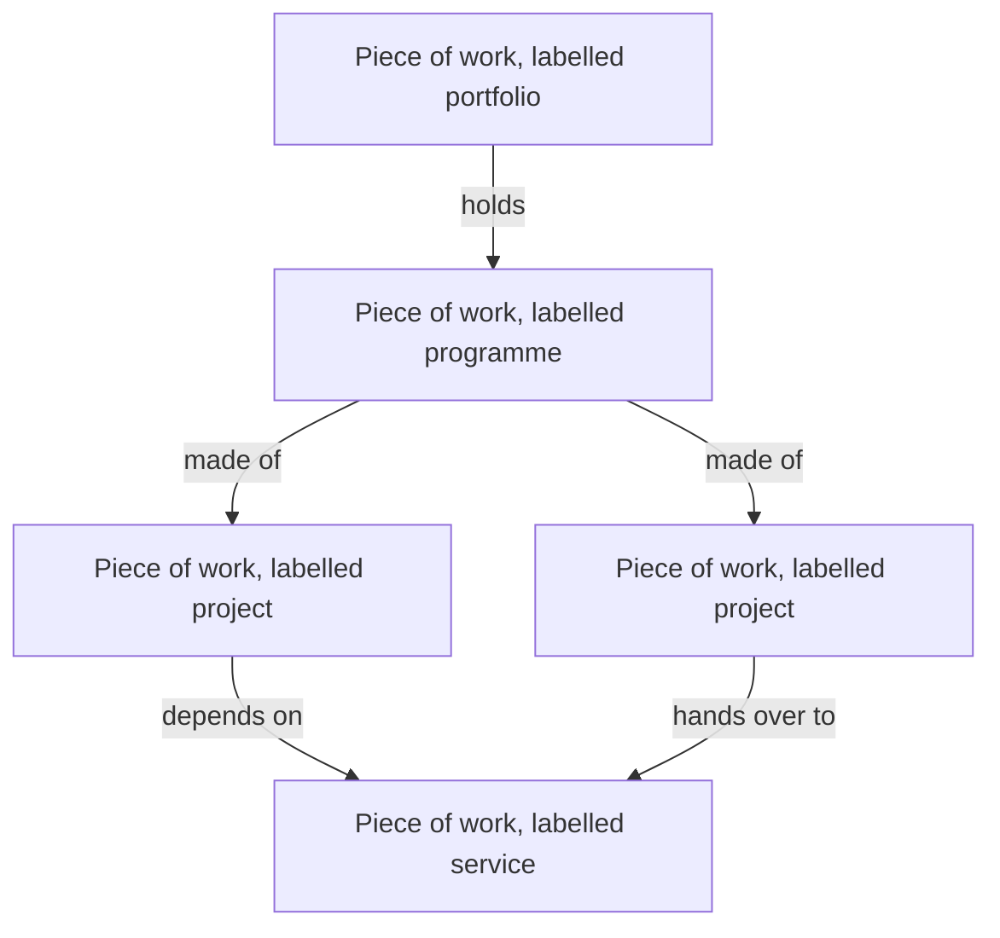

# DD-0004 One record for work at any scale

**Status:** Accepted
**Date:** 2026-10-17
**Requirements:** [R7](../../reference/requirements/shape-of-the-record.md#r7-outputs-outcomes-and-benefits-kept-apart), [R8](../../reference/requirements/shape-of-the-record.md#r8-accountability-named-and-handed-on), [R1](../../reference/requirements/shape-of-the-record.md#r1-one-shape-at-any-scale), [R2](../../reference/requirements/shape-of-the-record.md#r2-the-kind-is-a-label-given-after), [R3](../../reference/requirements/shape-of-the-record.md#r3-work-without-an-end), [R4](../../reference/requirements/shape-of-the-record.md#r4-typed-links-between-work), [R6](../../reference/requirements/shape-of-the-record.md#r6-one-place-for-each-concept), [P1](../../reference/requirements/people-and-first-use.md#p1-start-from-the-change-with-no-choice-first), [X1](../../reference/requirements/domains-and-configuration.md#x1-the-workspaces-taxonomy)

## Context

The project, programme and portfolio standards distinguish the three by purpose and by time. A project is temporary and delivers outputs. A programme is temporary and coordinates related work toward outcomes and benefits its parts share. A portfolio is part or all of an organisation's investment toward its objectives: it is managed in cycles with no end, and its members need not be related to one another ([APM](../../reference/bibliography.md), [PMI-STANDARDS](../../reference/bibliography.md), [PMI-PORTFOLIO](../../reference/bibliography.md) 1.2, [GOVS002](../../reference/bibliography.md) glossary, [TEAL](../../reference/bibliography.md) chapters 3 and 12, [ISO-21500](../../reference/bibliography.md)). They do not require different structures; the UK framework says an initiative can start as a project and be managed as a programme once further projects are added, so the kind follows the structure ([TEAL](../../reference/bibliography.md) 3.3). The open data standards use one record at any scale, with typed links between parents and children ([IATI](../../reference/bibliography.md), [OCDS](../../reference/bibliography.md), [360GIVING](../../reference/bibliography.md)). People stopped when asked to classify their work first ([FIELD](../../reference/bibliography.md)).

## Options

| Option | For | Against |
|---|---|---|
| A. A separate kind for each | Each kind's rules are explicit; matches the standards' terminology | Classification comes first ([P1](../../reference/requirements/people-and-first-use.md#p1-start-from-the-change-with-no-choice-first)); shapes duplicate ([R6](../../reference/requirements/shape-of-the-record.md#r6-one-place-for-each-concept)); changing kind moves data |
| B. One record, its kind a label | One shape to learn, exchange and render; the kind can change ([R2](../../reference/requirements/shape-of-the-record.md#r2-the-kind-is-a-label-given-after)) | Rules that differ by kind need another home |
| C. One record with fixed levels | A simple hierarchy | Fails work serving several parents ([R4](../../reference/requirements/shape-of-the-record.md#r4-typed-links-between-work)) and domains with other hierarchies ([X2](../../reference/requirements/domains-and-configuration.md#x2-results-hierarchies-mapped-to-reference-levels)) |

## Decision

Option B. The core record is a **piece of work**. Its label (project, programme, portfolio, service, grant, product, or a term from the organisation's taxonomy) comes from the profile and is suggested from what the person says. Rules that differ by label (one objective for a project, outcomes and components for a programme, a sponsor and a budget of its own) are **checks attached to the label in the profile**, never separate schemas. Links between pieces of work are typed (part of, depends on, funds, hands over to), declared on one side and read from both, and a piece of work may serve more than one parent ([R4](../../reference/requirements/shape-of-the-record.md#r4-typed-links-between-work)). Work with no end date has the same core, with a life of its own (planned, running, retired) and a reason recorded for retiring it ([R3](../../reference/requirements/shape-of-the-record.md#r3-work-without-an-end)).

A **portfolio** follows the standards' definition: a piece of work labelled portfolio that holds an organisation's standing investment in other work toward its goals ([PMI-PORTFOLIO](../../reference/bibliography.md) 1.2, [GOVS002](../../reference/bibliography.md) glossary, [TEAL](../../reference/bibliography.md) chapter 12). The checks on its label say what makes it one:

- it has no end date ([R3](../../reference/requirements/shape-of-the-record.md#r3-work-without-an-end));
- its intended results point to shared goals and hold no objectives of their own ([DD-0012](DD-0012-strategy-is-shared-context.md));
- the parts of the case about one change and how it comes about are not asked, because its members need not share an outcome;
- it names a sponsor, a budget and a review cycle ([S4](../../reference/requirements/stages-and-cycles.md#s4-a-groups-own-decision-points));
- its decisions fund, hold, stop or move money between its members, with the criteria it ranks them by when it uses them ([D10](../../reference/requirements/case-and-decisions.md#d10-portfolio-decisions)).

## Consequences

- One schema, one walk and one set of views serve every scale.
- "This may be a programme" becomes advice on a label, offered when the structure suggests it, not a choice at the door.
- A portfolio adds members from its own page, since membership is one link seen from either end.
- Members that need one another to bring about one change are a programme, not a portfolio; the tool advises the label when the structure suggests it.
- Every intended result is marked output, outcome or impact ([R7](../../reference/requirements/shape-of-the-record.md#r7-outputs-outcomes-and-benefits-kept-apart)), and every result, decision, indicator and risk names one accountable role at a time ([R8](../../reference/requirements/shape-of-the-record.md#r8-accountability-named-and-handed-on)), whatever the label.
- Rules lose the static guarantee a separate schema gives; checks enforce them.
