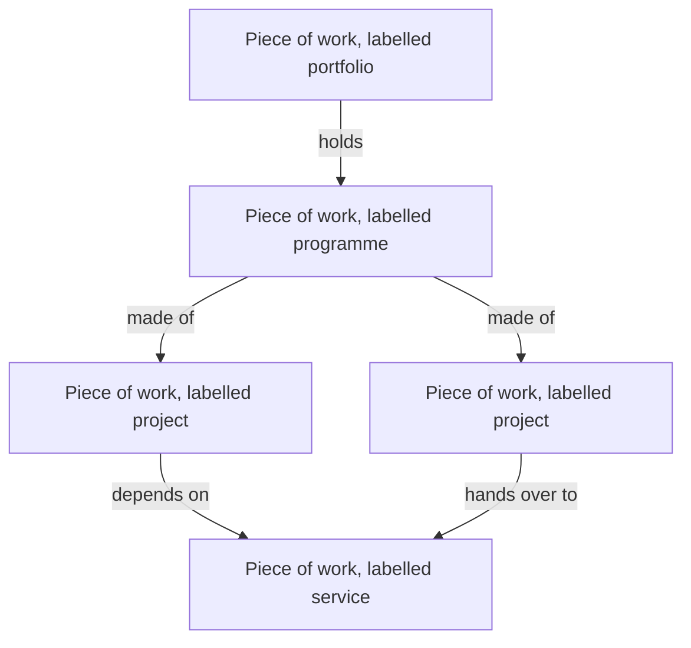

# DD-0004 One record for work at any scale

**Status:** Proposed
**Date:** 2026-10-17
**Requirements:** [R1](../../reference/requirements/shape-of-the-record.md#r1-one-shape-at-any-scale), [R2](../../reference/requirements/shape-of-the-record.md#r2-the-kind-is-a-label-given-after), [R3](../../reference/requirements/shape-of-the-record.md#r3-work-without-an-end), [R4](../../reference/requirements/shape-of-the-record.md#r4-typed-links-between-work), [R6](../../reference/requirements/shape-of-the-record.md#r6-one-place-for-each-concept), [P1](../../reference/requirements/people-and-first-use.md#p1-start-from-the-change-with-no-choice-first), [X1](../../reference/requirements/domains-and-configuration.md#x1-the-organisations-own-words)

## Context

The project, programme and portfolio standards distinguish the three by purpose: a project delivers outputs, a programme brings about outcomes through related work, a portfolio decides where to invest ([APM](../../reference/bibliography.md), [PMI-STANDARDS](../../reference/bibliography.md), [ISO-21500](../../reference/bibliography.md)). They do not require different structures; the PMI standard says a large project split into related projects with managed benefits becomes a programme, so the kind follows the structure. The open data standards use one record at any scale, with typed links between parents and children ([IATI](../../reference/bibliography.md), [OCDS](../../reference/bibliography.md), [360GIVING](../../reference/bibliography.md)). People stopped when asked to classify their work first ([FIELD](../../reference/bibliography.md)).

## Options

| Option | For | Against |
|---|---|---|
| A. A separate kind for each | Each kind's rules are explicit; matches the standards' words | Classification comes first ([P1](../../reference/requirements/people-and-first-use.md#p1-start-from-the-change-with-no-choice-first)); shapes duplicate ([R6](../../reference/requirements/shape-of-the-record.md#r6-one-place-for-each-concept)); changing kind moves data |
| B. One record, its kind a label | One shape to learn, exchange and render; the kind can change ([R2](../../reference/requirements/shape-of-the-record.md#r2-the-kind-is-a-label-given-after)) | Rules that differ by kind need another home |
| C. One record with fixed levels | A simple hierarchy | Fails work serving several parents ([R4](../../reference/requirements/shape-of-the-record.md#r4-typed-links-between-work)) and domains with other hierarchies ([X2](../../reference/requirements/domains-and-configuration.md#x2-the-shape-of-the-results-hierarchy)) |

## Decision (proposed)

Option B. The core record is a **piece of work**. Its label (project, programme, portfolio, service, grant, product, or the organisation's own words) comes from the profile and is suggested from what the person says. Rules that differ by label (one objective for a project, outcomes and components for a programme, a sponsor and a budget of its own) are **checks attached to the label in the profile**, never separate schemas. Links between pieces of work are typed and declared on one side.

## Consequences

- One schema, one walk and one set of views serve every scale.
- "This may be a programme" becomes advice on a label, offered when the structure suggests it, not a choice at the door.
- A portfolio adds members from its own page, since membership is one link seen from either end.
- Rules lose the static guarantee a separate schema gives; checks enforce them.

## Open questions

- Is a portfolio a piece of work, or a view over many with decisions of its own? This record treats it as a piece of work whose results are its objectives.
