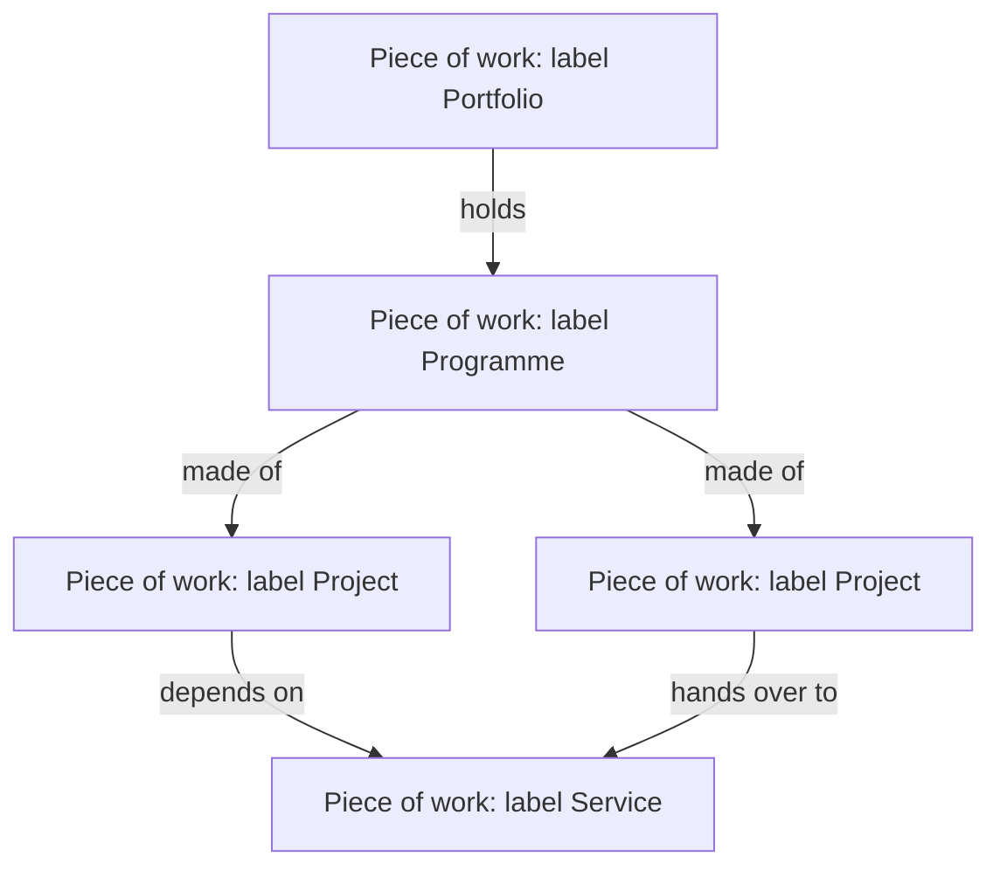

# DD-0004 One record for work at any scale

**Status:** Proposed
**Date:** 2026-10-17
**Requirements:** [R1](../../reference/requirements/shape-of-the-record.md#r1-one-shape-at-any-scale), [R2](../../reference/requirements/shape-of-the-record.md#r2-kind-is-a-label-given-after), [R3](../../reference/requirements/shape-of-the-record.md#r3-work-without-an-end), [R4](../../reference/requirements/shape-of-the-record.md#r4-typed-links-between-work), [R6](../../reference/requirements/shape-of-the-record.md#r6-one-place-for-each-concept), [P1](../../reference/requirements/people-and-first-use.md#p1-start-from-the-change-with-no-choice-first), [X1](../../reference/requirements/domains-and-configuration.md#x1-the-organisations-own-words)

## Context

Today a project, a programme, a portfolio, a service and a component are separate kinds with separate schemas (a project has 174 properties, a portfolio 10), and a person must choose one first. The standards that separate them (MSP, PMI, APM) do so by purpose, not by structure. The open standards (IATI's activity, OC4IDS's project, 360Giving's grant) use one record at any scale, with typed links between parents and children ([round 3, g4](../../../research/round-3/g4-first-principles.md), [g6](../../../research/round-3/g6-domains.md)).

## Options

| Option | For | Against |
|---|---|---|
| A. Separate kinds, as today | Each kind's rules are explicit; matches the PPM standards' words | Classification first ([P1](../../reference/requirements/people-and-first-use.md#p1-start-from-the-change-with-no-choice-first)); duplicated shapes ([R6](../../reference/requirements/shape-of-the-record.md#r6-one-place-for-each-concept)); changing kind means moving data |
| B. One record, kind as a label | One shape to learn, exchange and render; the kind can change ([R2](../../reference/requirements/shape-of-the-record.md#r2-kind-is-a-label-given-after)); matches open standards | Rules that differ by kind must be expressed another way |
| C. One record with fixed levels (portfolio over programme over project) | Simple hierarchy | Fails work that serves several parents ([R4](../../reference/requirements/shape-of-the-record.md#r4-typed-links-between-work)) and domains with other hierarchies ([X2](../../reference/requirements/domains-and-configuration.md#x2-the-shape-of-the-results-hierarchy)) |

## Decision (proposed)

Option B. The core record is a **piece of work**. Its label (project, programme, portfolio, service, grant, product, or the organisation's own words) comes from the profile ([DD-0008](DD-0008-profiles-hold-what-differs-between-domains.md)) and is suggested from what the person says. Rules that differ between a project and a programme (one objective against several outcomes; a sponsor and a budget of its own) are **checks keyed to the label**, written in the profile, never separate schemas. Links between pieces of work are typed (part of, depends on, funds, replaces), declared on one side.

## Consequences

- One schema, one walk, one set of views for all scales; the sizes of today's kinds stop mattering.
- The tests "this may be a programme" (one sponsor and budget; outputs or outcomes) become advice on the label, not a choice at the door.
- Portfolio membership and programme components are the same link type seen from either end, so a portfolio can add members from its own page.
- Some rules lose the static guarantee a separate schema gives; they are enforced by checks.

## Open questions

- Is a portfolio a piece of work, or a view over many with its own decisions? This record treats it as a piece of work whose results are its objectives; [DD-0007](DD-0007-decisions-stages-and-reviews-are-records.md) gives it decisions.
