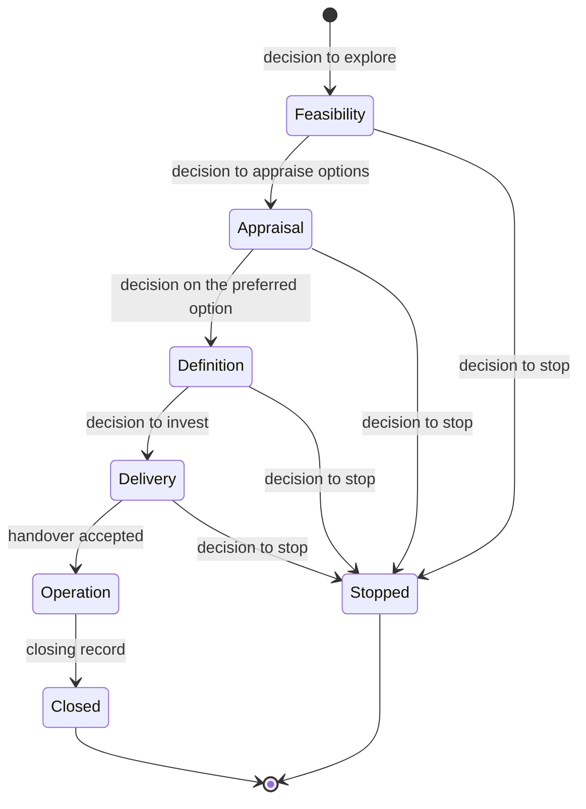

# DD-0007 Decisions, stages and reviews are records

**Status:** Proposed
**Date:** 2026-10-17
**Requirements:** [X3](../../reference/requirements/domains-and-configuration.md#x3-a-decider-at-every-decision-point), [A6](../../reference/requirements/risk-and-assurance.md#a6-planned-assurance), [D11](../../reference/requirements/case-and-decisions.md#d11-still-relevant-and-not-duplicated), [D5](../../reference/requirements/case-and-decisions.md#d5-a-decision-is-a-record), [D6](../../reference/requirements/case-and-decisions.md#d6-conditions-on-a-decision), [D7](../../reference/requirements/case-and-decisions.md#d7-stopping-is-ordinary), [D8](../../reference/requirements/case-and-decisions.md#d8-an-approved-plan-and-changes-to-it), [D10](../../reference/requirements/case-and-decisions.md#d10-portfolio-decisions), [S1](../../reference/requirements/stages-and-cycles.md#s1-life-cycles-mapped-to-a-reference), [S2](../../reference/requirements/stages-and-cycles.md#s2-the-current-stage-shown-against-the-reference), [S3](../../reference/requirements/stages-and-cycles.md#s3-cycles-without-gates), [S4](../../reference/requirements/stages-and-cycles.md#s4-a-groups-own-decision-points), [A5](../../reference/requirements/risk-and-assurance.md#a5-reviews-are-records-apart-from-approvals), [E7](../../reference/requirements/change-and-evaluation.md#e7-findings-change-decisions-and-lessons-are-found), [B4](../../reference/requirements/benefits-handover-closure.md#b4-benefits-tracked-after-closure), [B5](../../reference/requirements/benefits-handover-closure.md#b5-accepted-at-handover), [B6](../../reference/requirements/benefits-handover-closure.md#b6-a-closing-record-and-a-look-back)

## Context

Every life cycle studied turns on a few acts: a decision at a point in the work's life, a review before or after it, a handover, a look back at benefits, and lessons ([GOVS002](../../reference/bibliography.md), [HMT-CASES](../../reference/bibliography.md), [NISTA-GATES](../../reference/bibliography.md), [WB-CYCLE](../../reference/bibliography.md), [EC-PM2](../../reference/bibliography.md)).

## Options

| Option | For | Against |
|---|---|---|
| A. Fields on the piece of work | Small | History is lost; a review and its recommendations do not fit a field |
| B. Small records of their own, linked to the work and to a version of its case | Each has its own life, owner and history, at any scale | More records to show; the walk must stay light |
| C. A workflow engine | Powerful | Builds one method in; fails work steered by cycles rather than gates ([S3](../../reference/requirements/stages-and-cycles.md#s3-cycles-without-gates)) |

## Decision (proposed)

Option B, with these records:

| Record | Holds |
|---|---|
| **Decision** | Who decided, in what role (the deciding role the decision point names, or the author alone in a workspace of one, [X3](../../reference/requirements/domains-and-configuration.md#x3-a-decider-at-every-decision-point)), when; the outcome (approve, approve with conditions, change the scope, try another option, pilot, defer, stop); the reasons; the version of the case; its conditions |
| **Stage** | A part of the work's life between two decision points, named in the workspace's taxonomy and mapped to a reference stage |
| **Review** | When, what it looked at, who and how independent they were (self-review, peer review or independent review, at least what the profile sets for the decision point, [A5](../../reference/requirements/risk-and-assurance.md#a5-reviews-are-records-apart-from-approvals)), findings, recommendations with owners; never an approval |
| **Lesson** | What was learned and where it applies |
| **Handover** | Who accepts the result, the benefits' tracking and the open risks and actions, when, on what terms |
| **Benefit review** | Whether a benefit is realised, on track, off track or stopped |
| **Closing record** | What was delivered against what was approved, what remains and who answers for it, what the benefits need to last, lessons, how well the work was governed, and the review planned after ([B6](../../reference/requirements/benefits-handover-closure.md#b6-a-closing-record-and-a-look-back)) |

The diagram is the reference life cycle ([S1](../../reference/requirements/stages-and-cycles.md#s1-life-cycles-mapped-to-a-reference)); a profile's life cycle maps to it, and work steered by cycles has decisions and reviews on its cycle and no stages ([S3](../../reference/requirements/stages-and-cycles.md#s3-cycles-without-gates)).

## Consequences

- A decision point lists the reviews expected before it ([A6](../../reference/requirements/risk-and-assurance.md#a6-planned-assurance)), and a review can record whether the objectives remain relevant and what other work overlaps ([D11](../../reference/requirements/case-and-decisions.md#d11-still-relevant-and-not-duplicated)).
- Each condition has an owner, a due point and what it holds back, and an unmet one past its due point shows on the work ([D6](../../reference/requirements/case-and-decisions.md#d6-conditions-on-a-decision)).
- A programme has no reference life cycle: it is phased in tranches, and a programme or portfolio has decisions and reviews of its own, apart from its members' ([S4](../../reference/requirements/stages-and-cycles.md#s4-a-groups-own-decision-points)).
- A portfolio's decisions to fund, hold or stop are decisions on its members ([D10](../../reference/requirements/case-and-decisions.md#d10-portfolio-decisions)).
- Changing the approved plan is a decision, apart from correcting a mistake ([D8](../../reference/requirements/case-and-decisions.md#d8-an-approved-plan-and-changes-to-it)).
- A finding links to the decision it informed ([E7](../../reference/requirements/change-and-evaluation.md#e7-findings-change-decisions-and-lessons-are-found)).
