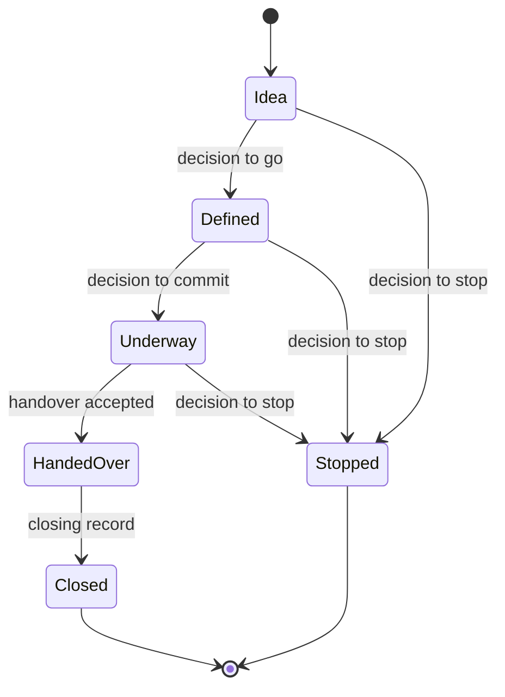

# DD-0007 Decisions, stages and reviews are records

**Status:** Proposed
**Date:** 2026-10-17
**Requirements:** [D5](../../reference/requirements/case-and-decisions.md#d5-a-decision-is-a-record), [D6](../../reference/requirements/case-and-decisions.md#d6-conditions-on-a-decision), [D7](../../reference/requirements/case-and-decisions.md#d7-stopping-is-ordinary), [D8](../../reference/requirements/case-and-decisions.md#d8-a-baseline-and-changes-to-it), [D10](../../reference/requirements/case-and-decisions.md#d10-portfolio-decisions), [S1](../../reference/requirements/stages-and-cycles.md#s1-where-it-is-in-its-life), [S2](../../reference/requirements/stages-and-cycles.md#s2-stages-are-data), [S3](../../reference/requirements/stages-and-cycles.md#s3-cycles-without-gates), [S4](../../reference/requirements/stages-and-cycles.md#s4-a-groups-own-decision-points), [A5](../../reference/requirements/risk-and-assurance.md#a5-reviews-are-records-apart-from-approvals), [E7](../../reference/requirements/change-and-evaluation.md#e7-findings-change-decisions-and-lessons-are-found), [B4](../../reference/requirements/benefits-handover-closure.md#b4-readings-after-closure), [B5](../../reference/requirements/benefits-handover-closure.md#b5-accepted-at-handover), [B6](../../reference/requirements/benefits-handover-closure.md#b6-a-closing-record-and-a-look-back)

## Context

Every life cycle read turns on the same few acts: a decision at a point in the work's life, a review before or after it, a lesson, a handover, and a look at the benefits after delivery ([round 3, g3 section 2](../../../research/round-3/g3-life-cycle.md)). Today Cartograph has sign-offs and an event log on a project, and nothing for a programme or portfolio; TAXONOMY says "Tranche: nothing".

## Options

| Option | For | Against |
|---|---|---|
| A. Fields on the piece of work (a status, a list of sign-offs) | Small | Loses history; a review and its recommendations do not fit a field |
| B. Small records of their own, linked to the work and to a version of its case | Each has its own life, owner and history; any scale can have them | More records to show; needs a careful walk |
| C. A full workflow engine | Powerful | A method built in; fails [X3](../../reference/requirements/domains-and-configuration.md#x3-the-approval-route) and [S3](../../reference/requirements/stages-and-cycles.md#s3-cycles-without-gates) for domains without gates |

## Decision (proposed)

Option B, with these records:

| Record | Holds |
|---|---|
| **Decision** | Who decided, in what role, when, the outcome (go, go with conditions, revise, defer, stop), the reasons, the version of the case it rested on, its conditions |
| **Stage** | Where the work is in its life, entered by a decision; the stage model is the profile's ([DD-0008](DD-0008-profiles-hold-what-differs-between-domains.md)) |
| **Review** | When, what it looked at, who (never the author), findings, recommendations with owners; never called an approval |
| **Lesson** | What was learned, where it applies, so later work can find it |
| **Handover** | Who accepts the result, the benefit tracking, and the open risks and actions |
| **Benefit review** | Whether a benefit is realised, on track, off track or stopped, after delivery |

The diagram shows the default stage model only; a profile replaces it, and work steered by cycles has decisions and reviews on its cycle with no stages ([S3](../../reference/requirements/stages-and-cycles.md#s3-cycles-without-gates)).

## Consequences

- A portfolio's invest, hold and stop are decisions on its members ([D10](../../reference/requirements/case-and-decisions.md#d10-portfolio-decisions)).
- Change control is a decision that changes the baseline ([D8](../../reference/requirements/case-and-decisions.md#d8-a-baseline-and-changes-to-it)), apart from an edit.
- A review that finds something links to the decision it informed ([E7](../../reference/requirements/change-and-evaluation.md#e7-findings-change-decisions-and-lessons-are-found)).
