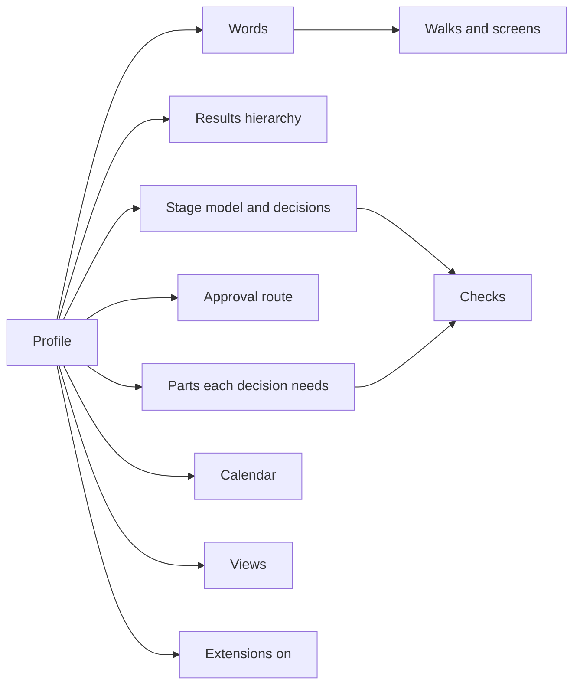

# DD-0008 Profiles hold what differs between domains

**Status:** Proposed
**Date:** 2026-10-17
**Requirements:** [X1](../../reference/requirements/domains-and-configuration.md#x1-the-organisations-own-words), [X2](../../reference/requirements/domains-and-configuration.md#x2-the-shape-of-the-results-hierarchy), [X3](../../reference/requirements/domains-and-configuration.md#x3-the-approval-route), [X4](../../reference/requirements/domains-and-configuration.md#x4-profiles-as-starting-points), [X7](../../reference/requirements/domains-and-configuration.md#x7-the-organisations-calendar), [S2](../../reference/requirements/stages-and-cycles.md#s2-stages-are-data), [P4](../../reference/requirements/people-and-first-use.md#p4-the-persons-words)

## Context

The domain survey found the same core everywhere and differences in nine places: words, the shape of the results hierarchy, stage names and count, the approval route, mandatory documents, measurement conventions, reporting cycles, the unit of management, and language ([round 3, g6 section 4](../../../research/round-3/g6-domains.md)). Built in, any one answer serves one domain.

## Options

| Option | For | Against |
|---|---|---|
| A. Fixed design with relabelling only | Simple; today's D70 and D71 | Stages, routes and hierarchy depth stay one domain's |
| B. Profiles as data, set per workspace and changeable | Each domain expresses itself; one engine | Profiles must be validated; more combinations to test |
| C. A fork or edition per domain | Tailored | Many products to maintain; nothing shared |

## Decision (proposed)

Option B. A **profile** is data in the workspace that sets: the words for levels, labels, stages and roles; the results hierarchy (its depth, its names, tree or matrix); the stage model and the decision at each point; the approval route; the parts each decision needs; the reporting calendar; the views on offer; the extensions turned on. Cartograph ships a few starting profiles (for example public investment, project delivery, product team, charity, research, improvement); an organisation starts from one and changes it.

## Consequences

- The engine reads the profile to serve flows, words and checks; nothing domain-specific is compiled in.
- Changing a profile on a workspace with records needs rules: a stage removed while work sits in it, a label renamed.
- Whether people want to choose a profile at the start is untested ([X4](../../reference/requirements/domains-and-configuration.md#x4-profiles-as-starting-points) is Should); the first walk may infer it later.

## Open questions

- Can two profiles live in one workspace (a public body that runs both a capital programme and a product team)?
