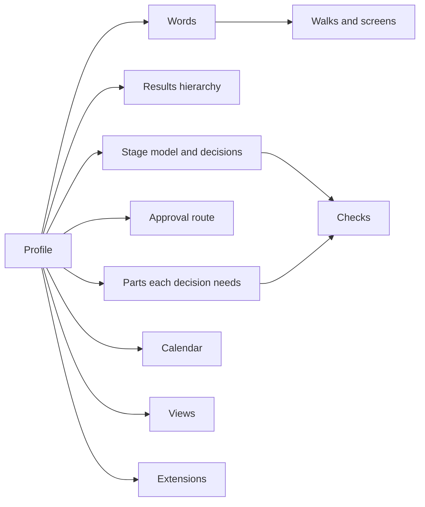

# DD-0008 Profiles hold what differs between domains

**Status:** Proposed
**Date:** 2026-10-17
**Requirements:** [X1](../../reference/requirements/domains-and-configuration.md#x1-the-organisations-own-words), [X2](../../reference/requirements/domains-and-configuration.md#x2-the-shape-of-the-results-hierarchy), [X3](../../reference/requirements/domains-and-configuration.md#x3-the-approval-route), [X4](../../reference/requirements/domains-and-configuration.md#x4-profiles-as-starting-points), [X7](../../reference/requirements/domains-and-configuration.md#x7-the-organisations-calendar), [S2](../../reference/requirements/stages-and-cycles.md#s2-stages-are-data), [P4](../../reference/requirements/people-and-first-use.md#p4-the-persons-own-words)

## Context

The frameworks share a core and differ in their words, the shape of their results hierarchy, their stages, their approval routes, what each step requires, how they read targets and their reporting calendars ([the evidence](../the-evidence.md); [TBS-RESULTS](../../reference/bibliography.md), [OMB-A11](../../reference/bibliography.md), [EC-PCM](../../reference/bibliography.md), [OKR](../../reference/bibliography.md), [EC-PM2](../../reference/bibliography.md), [RIBA](../../reference/bibliography.md), [SCRUM](../../reference/bibliography.md)). Any one answer built in serves one domain.

## Options

| Option | For | Against |
|---|---|---|
| A. A fixed design that can only be relabelled | Simple | Stages, routes and hierarchy stay one domain's |
| B. Profiles as data, set per workspace and changeable | Each domain expresses itself in one product | Profiles must be validated, and combinations tested |
| C. An edition per domain | Tailored | Many products to maintain, little shared |

## Decision (proposed)

Option B. A **profile** is data in a workspace that sets the words for levels, labels, stages and roles; the results hierarchy; the stage model and the decision at each point; the approval route; the parts each decision needs; the reporting calendar; the views offered; and the extensions turned on. Cartograph ships starting profiles (for example public investment, project delivery, product team, charity, research, improvement), and an organisation starts from one and changes it.

## Consequences

- The engine serves walks, words and checks from the profile; nothing domain-specific is compiled in.
- Changing a profile in use needs rules, for example for work sitting in a stage that is removed.
- Whether people want to choose a profile at the start is untested ([X4](../../reference/requirements/domains-and-configuration.md#x4-profiles-as-starting-points) is a Should).

## Open questions

- Can one workspace hold two profiles, for a body that runs both a capital programme and a product team?
