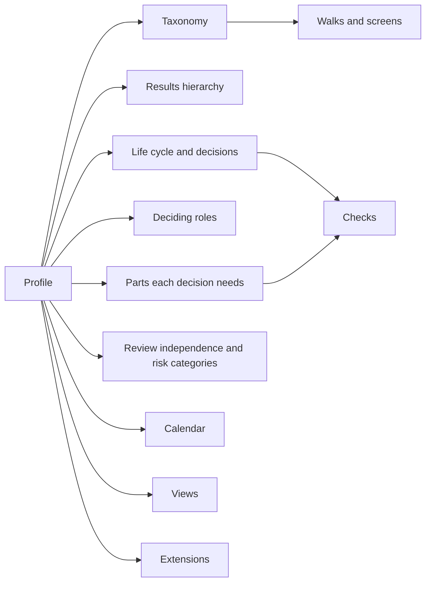

# DD-0008 Profiles hold what differs between domains

**Status:** Accepted
**Date:** 2026-10-17
**Requirements:** [A3](../../reference/requirements/risk-and-assurance.md#a3-appetite-and-tolerance), [A5](../../reference/requirements/risk-and-assurance.md#a5-reviews-are-records-apart-from-approvals), [E8](../../reference/requirements/change-and-evaluation.md#e8-evaluation-lenses-as-views), [X1](../../reference/requirements/domains-and-configuration.md#x1-the-workspaces-taxonomy), [X2](../../reference/requirements/domains-and-configuration.md#x2-results-hierarchies-mapped-to-reference-levels), [X3](../../reference/requirements/domains-and-configuration.md#x3-a-decider-at-every-decision-point), [X4](../../reference/requirements/domains-and-configuration.md#x4-standard-profiles-tailored-within-their-references), [X7](../../reference/requirements/domains-and-configuration.md#x7-reporting-periods-as-date-intervals), [S1](../../reference/requirements/stages-and-cycles.md#s1-life-cycles-mapped-to-a-reference), [P4](../../reference/requirements/people-and-first-use.md#p4-the-persons-vocabulary)

## Context

The frameworks share a core and differ in their vocabulary, the shape of their results hierarchy, their stages, their approval routes, what each step requires, how they read targets and their reporting calendars ([the evidence](../the-evidence.md); [TBS-RESULTS](../../reference/bibliography.md), [OMB-A11](../../reference/bibliography.md), [EC-PCM](../../reference/bibliography.md), [OKR](../../reference/bibliography.md), [EC-PM2](../../reference/bibliography.md), [RIBA](../../reference/bibliography.md), [SCRUM](../../reference/bibliography.md)). Any one answer built in serves one domain.

## Options

| Option | For | Against |
|---|---|---|
| A. A fixed design that can only be relabelled | Simple | Stages, routes and hierarchy stay one domain's |
| B. Profiles as data, set per workspace and changeable | Each domain expresses itself in one product | Profiles must be validated, and combinations tested |
| C. An edition per domain | Tailored | Many products to maintain, little shared |

## Decision

Option B. A **profile** is data in a workspace that sets the taxonomy for levels, labels, stages and roles; the results hierarchy; the life cycle and the decision at each point; a programme's decision points and the cycles that steer ongoing work ([DD-0019](DD-0019-tranches-are-records-of-a-programme.md), [DD-0020](DD-0020-cycles-are-profile-patterns.md)); the deciding role at each decision point; the least review independence each needs and the reviews planned before it; the parts and evaluation lenses each decision needs; the risk categories and scale; the reporting calendar; the views offered; and the extensions turned on. Each part is chosen from a recognised pattern and mapped to a fixed reference: the standard terms, the reference results levels, the reference life cycle, the reference cycle, date intervals for periods. Cartograph ships standard profiles (for example public investment, project delivery, product team, charity, research, improvement); an organisation starts from one and tailors it only within those references.

## Consequences

- The engine serves walks, vocabulary and checks from the profile; nothing domain-specific is compiled in.
- A tailoring that would break a mapping to its reference cannot be saved.
- A workspace may be bound by a policy that fixes parts of its profile ([X9](../../reference/requirements/domains-and-configuration.md#x9-policies-that-bind-workspaces)); it then tailors only the parts the policy leaves open.
- Changing a profile in use needs rules, for example for work sitting in a stage that is removed.
- Whether people want to choose a profile at the start is untested ([X4](../../reference/requirements/domains-and-configuration.md#x4-standard-profiles-tailored-within-their-references) is a Should).

## Settled questions

- **Can one workspace hold two profiles, for a body that runs both a capital programme and a product team?** Yes. One body runs work of several kinds, and each kind follows its own recognised pattern: a project its life cycle ([S1](../../reference/requirements/stages-and-cycles.md#s1-life-cycles-mapped-to-a-reference)), a programme its framework, a product or service its cycle. A workspace therefore holds as many profiles as the kinds of work it runs, and each piece of work is read through one of them. Because every profile maps to the same fixed references and its terms belong to the workspace's one taxonomy ([X1](../../reference/requirements/domains-and-configuration.md#x1-the-workspaces-taxonomy)), work under different profiles stays comparable and can be linked across them ([R4](../../reference/requirements/shape-of-the-record.md#r4-typed-links-between-work), [D9](../../reference/requirements/case-and-decisions.md#d9-the-chain-upward)).
