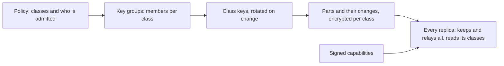

# DD-0022 Access classes, enforced by group keys and signed capabilities, behind a port

**Status:** Accepted
**Date:** 2026-10-23
**Requirements:** [K11](../../reference/requirements/platform.md#k11-access-by-part-enforced-by-keys), [O5](../../reference/requirements/openness-and-exchange.md#o5-personal-data-separable), [K8](../../reference/requirements/platform.md#k8-local-first), [K9](../../reference/requirements/platform.md#k9-live-and-private-drafts), [K10](../../reference/requirements/platform.md#k10-encrypted-by-default), [X9](../../reference/requirements/domains-and-configuration.md#x9-policies-that-bind-workspaces)

## Context

Today the keys of a workspace decide who may read and write it ([DD-0013](DD-0013-roles-in-the-record-people-outside.md)), so every member can read every part. Some parts must be read by fewer: personal data, some findings ([O5](../../reference/requirements/openness-and-exchange.md#o5-personal-data-separable)), the record an auditor alone may inspect. Collaboration sends every change to every member's device ([K8](../../reference/requirements/platform.md#k8-local-first), [K9](../../reference/requirements/platform.md#k9-live-and-private-drafts)), so a part hidden only by an interface is still readable on that device, and a change to a protected part reveals it to whoever can read the change. Access control by attributes evaluates attributes of the person, the object and the action against a policy ([NIST-ABAC](../../reference/bibliography.md)); least privilege grants only what a function needs ([NIST-800-53](../../reference/bibliography.md)); data protection by default keeps personal data from an indefinite number of people ([GDPR](../../reference/bibliography.md) article 25(2)). Tailscale shows a policy written as data, denying by default and granting by group, tag and capability, enforced with keys rather than a central check ([TAILSCALE-GRANTS](../../reference/bibliography.md)). Messaging Layer Security agrees a group's key as members join and leave, with forward secrecy and recovery after compromise ([MLS](../../reference/bibliography.md)). Keyhive applies group key agreement and signed capabilities to local-first documents, but its code is pre-alpha and not for production ([KEYHIVE](../../reference/bibliography.md)).

## Options

| Option | Makes easy | Makes hard |
|---|---|---|
| A. One key per workspace, as now | Simple; already designed | Every member reads every part; [O5](../../reference/requirements/openness-and-exchange.md#o5-personal-data-separable) cannot be enforced among members |
| B. A server checks each read | Fine-grained, dynamic rules | Breaks [K10](../../reference/requirements/platform.md#k10-encrypted-by-default) and [K8](../../reference/requirements/platform.md#k8-local-first): the server must read the records, and offline devices hold everything |
| C. Attribute-based encryption, a key per policy expression | Each part encrypted to an attribute formula | No settled standard; heavy keys; revocation hard |
| D. Access classes, each a group with its own key agreed as members change, and signed capabilities for writing; the policy is data and compiles to group membership | Enforced on every device, offline included; follows a published standard for group keys; policy reviewed like the rest of the profile | Attributes are evaluated when membership changes, not at each read; what a member has read cannot be withdrawn |

## Decision

Option D. A profile or a policy ([X9](../../reference/requirements/domains-and-configuration.md#x9-policies-that-bind-workspaces)) names **access classes** and assigns parts of the record to them, and states, by role and attribute, who is admitted to each, denying by default. Each class is a **key group**: its key is agreed and rotated as members join and leave, using a continuous group key agreement that meets Messaging Layer Security's properties, or Keyhive's once it is fit for production. A part in a class, and every change to it, is encrypted under the class's key, so it travels to all replicas but is readable only by members. Writing needs a **capability**, signed and delegable, that every replica checks before it applies a change. The engine knows only the port: an access module behind it holds keys, evaluates the policy into memberships and hands the engine the parts its user may read. A workspace with one class behaves as today.

## Consequences

- A personal-data field can be read by an auditor and not by another reviewer of the same record.
- A server, a relay or a member without a class's key stores and forwards its parts without reading them.
- Removing a person rotates the class's key: they cannot read later changes, and what they had read stays read; the record says so.
- Attributes that change by the minute (time of day, device state) cannot be enforced by keys alone; they apply when membership is evaluated.
- That a protected part exists, and its size, may still be visible; the class hides its content, not its presence.
- A check that needs a protected part runs only where the part can be read, and answers "not judged" elsewhere ([DD-0017](DD-0017-agents-propose-meaning-behind-a-port.md)).
- Losing every member's key loses the class; recovery needs a recovery member named in the policy.

## Open questions

- Which group key agreement to adopt first: a library implementing Messaging Layer Security, or Keyhive once it leaves pre-alpha.
- How statutory access (an auditor's) is arranged where a law requires it, and how it is shown in the record.
