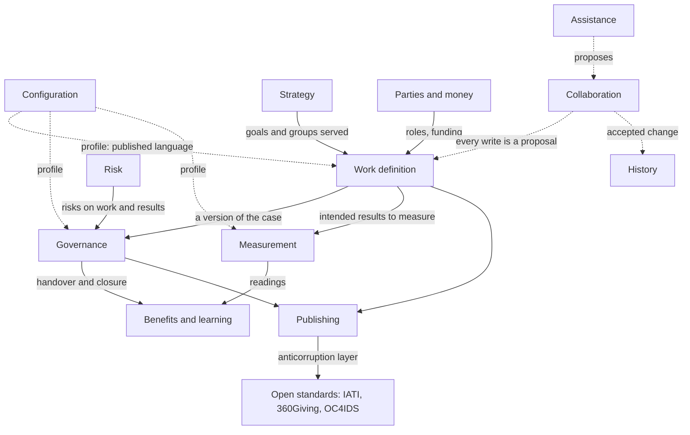

# The domain model

This page explains how the new model divides Cartograph's domain into parts, using domain-driven design, and why the boundaries fall where they do. The parts themselves, their records, rules and events, are listed in [the domain catalogue](../reference/domain-catalogue.md). The division is proposed in [DD-0015](decisions/DD-0015-bounded-contexts.md).

## Why domain-driven design

The current model grew kind by kind, and words drifted: "decision" means a governance act and a language model's judgement; "review" means checking a change and an assurance review; "KPI" and "indicator" name one thing. Domain-driven design answers this with **bounded contexts**: parts of the model each with its own language and rules, joined by explicit relations. Inside a context a word means one thing ([the glossary](../reference/glossary.md)).

It also separates what must be excellent from what only has to work. The **core domain** is where Cartograph earns its place; **supporting** parts are specific to it but not its reason for being; **generic** parts are problems others have solved.

## The contexts

| Context | Type | Responsible for |
|---|---|---|
| Work definition | Core | The piece of work, its label, its case (need, change wanted, if nothing is done, options, intended results, the theory of change, assumptions) and its links to other work |
| Governance | Core | Decisions, stages, conditions, reviews, baselines, handovers |
| Measurement | Core | Indicators, targets, readings, data sources |
| Benefits and learning | Core | Benefits and disbenefits, benefit reviews, evaluation questions, findings, lessons |
| Strategy | Supporting | Purpose, goals, gaps, groups affected: the shared context work serves |
| Risk | Supporting | Risks, issues, dependencies, appetite and tolerance, escalation |
| Parties and money | Supporting | Organisations and roles, funding sources, funding lines and allocations |
| Configuration | Supporting | Profiles: words, hierarchy, stage model, approval route, required parts, calendar, views, extensions |
| Publishing | Supporting | Views, printing, exchange mappings, identifiers, packages |
| Assistance | Supporting | Agents' access and the meaning model |
| Collaboration | Generic | Proposals, comments, access, presence |
| History | Generic | The journal of versions and who changed what |

Four contexts are core because they hold what no other tool holds together: the case and how it grows, the decisions on it, how progress is known, and what happened after. The research found these are what every domain shares and what generic work trackers lack ([round 3, g3 section 2](../../research/round-3/g3-life-cycle.md)).

## How they relate

The relations, in domain-driven design's terms:

- **Configuration publishes a language** the other contexts read: the profile's words, stages and required parts. They conform to it and never change it.
- **Work definition is upstream of Governance.** A decision refers to a version of the case and never edits it.
- **Measurement is downstream of Work definition** for what to measure, and upstream of Benefits and learning, which reads readings to judge benefits.
- **Publishing keeps an anticorruption layer** toward the open standards, so their shapes never leak into the model ([DD-0016](decisions/DD-0016-exchange-through-mappings.md)).
- **Collaboration and History wrap every write.** A change to any context is a proposal; accepting it appends to the journal ([DD-0014](decisions/DD-0014-proposals-with-a-straight-in-policy.md), [DD-0011](decisions/DD-0011-documents-with-an-append-only-journal.md)).

## Where the boundaries were hard

**Is the case part of the work, or its own aggregate?** The case changes with the work, is versioned with it and has no life apart from it, so it is part of the piece of work. A decision, which has its own author, date and life, is not.

**Is a benefit a record of its own?** A benefit is an intended result of the work with an owner, a measure and a date. Today Cartograph has no benefit kind, building one from goals, indicators and groups (D4, D9 in the engine's TAXONOMY). The new model keeps that idea for the definition and adds what happens after: benefit reviews, in Benefits and learning, because they outlive the work.

**Is a portfolio a piece of work?** It is treated as one, whose results are its objectives and whose decisions fund, hold or stop its members. The alternative, a view over many pieces of work, would give it nowhere to keep its own reviews ([DD-0004 open questions](decisions/DD-0004-one-record-for-work-at-any-scale.md#open-questions)).

**Why is Strategy supporting, not core?** Purpose and goals matter, but they are shared context that work points at, and the logic is simple. The hard problems are in how work justifies itself against them.

## Related

- [The domain catalogue](../reference/domain-catalogue.md)
- [The glossary](../reference/glossary.md)
- [The architecture](architecture.md)
