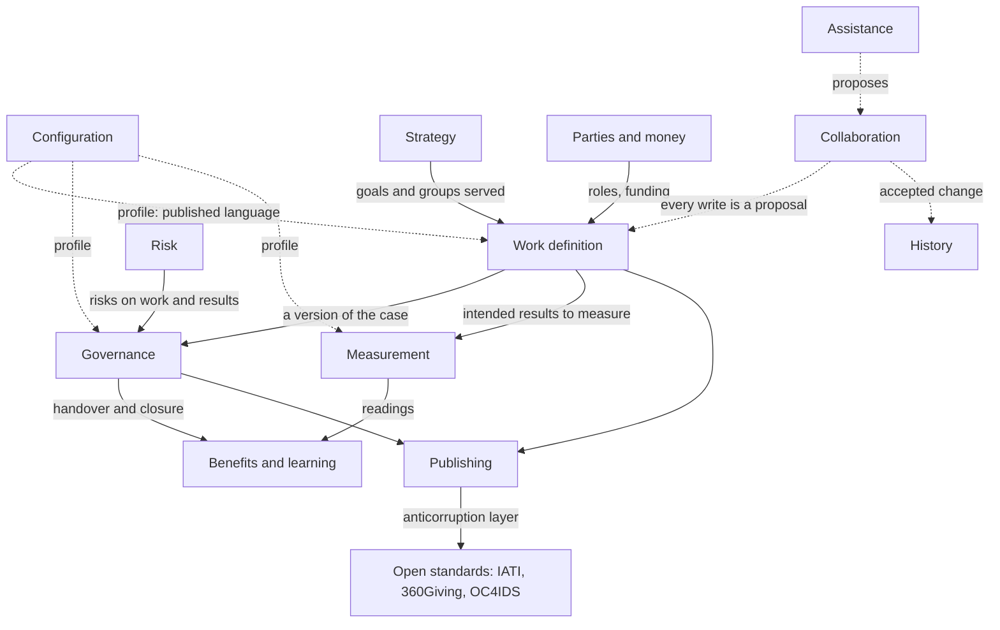

# The domain model

This page explains how the new model divides Cartograph's domain into parts, using domain-driven design, and why the boundaries fall where they do. The parts themselves, their records, rules and events, are listed in [the domain catalogue](../reference/domain-catalogue.md). The division is decided in [DD-0015](decisions/DD-0015-bounded-contexts.md).

## Why domain-driven design

A model that grows without boundaries lets its words drift: "decision" comes to mean both a governance act and a language model's judgement, "review" both accepting a change and an assurance review, and two words may be used to describe the same measure. Domain-driven design answers this with **bounded contexts**: parts of the model each with its own language and rules, joined by explicit relations. Inside a context vocabulary remains consistent among its users, and a word has a single, unambiguous meaning ([the glossary](../reference/glossary.md)).

It also separates what must be excellent from what only has to work. The **core domain** is where Cartograph earns its place; **supporting** parts are specific to it but not its reason for being; **generic** parts are problems others have solved.

## The contexts

| Context | Type | Responsible for |
|---|---|---|
| Work definition | Core | The piece of work, its label, its life (planned, running, retired or stopped, with the reason), the depth agreed for it, its case under the five questions (need, change wanted, if nothing is done, options, intended results, the theory of change, assumptions, cost, delivery) and its links to other work |
| Governance | Core | Decisions, stages and cycles, a programme's tranches, conditions, reviews and their independence, the approved plan, handovers, closing records |
| Measurement | Core | Indicators on their scales, with their aggregation rules, targets, readings and their breakdowns, data sources |
| Benefits and learning | Core | Benefits and disbenefits, benefit reviews, evaluation plans and their questions, findings, lessons |
| Strategy | Supporting | Purpose, goals, gaps, groups affected: the shared context work serves |
| Risk | Supporting | Risks, issues, dependencies, appetite and tolerance, escalation |
| Parties and money | Supporting | Organisations and roles, funding sources, funding lines and allocations |
| Configuration | Supporting | Profiles: taxonomy, results hierarchy, life cycle, deciding roles, review independence, risk categories, required parts and lenses, calendar, views, extensions, each mapped to its reference |
| Publishing | Supporting | Views, printing, exchange mappings, identifiers, packages |
| Assistance | Supporting | Agents' access and the language model |
| Collaboration | Generic | Replicas and their synchronisation, drafts, proposals, comments, access by keys, presence |
| History | Generic | The journal of versions and who changed what |

Four contexts are core because they hold what no other tool holds together: the case and how it grows, the decisions on it, how progress is known, and what happened after. They are what every domain studied shares and what general tools for tracking work lack ([the evidence](the-evidence.md)).

## How they relate

The relations, in domain-driven design's terms:

- **Configuration publishes a language** the other contexts read: the profile's taxonomy, results hierarchy, life cycle, deciding roles and required parts. They conform to it and never change it, and the profile itself is tailored only within the fixed references each part maps to.
- **Work definition is upstream of Governance.** A decision refers to a version of the case and never edits it.
- **Measurement is downstream of Work definition** for what to measure, and upstream of Benefits and learning, which reads readings to judge benefits.
- **Publishing keeps an anticorruption layer** toward the open standards, so their shapes never leak into the model ([DD-0016](decisions/DD-0016-exchange-through-mappings.md)).
- **Collaboration and History wrap every write.** A change to any context is a proposal, prepared in a draft; the workspace's policy says whether it is accepted at once or waits, an agent's always waits, and accepting it appends to the journal ([DD-0014](decisions/DD-0014-proposals-saved-straight-in-when-alone.md), [DD-0011](decisions/DD-0011-documents-with-an-append-only-journal.md), [DD-0018](decisions/DD-0018-live-co-editing-in-drafts.md)).

## Where the boundaries were hard

**Is the case part of the work, or its own aggregate?** The case changes with the work, is versioned with it and has no life apart from it, so it is part of the piece of work. A decision, which has its own author, date and life, is not.

**Is a benefit a record of its own?** A benefit is an intended result of the work with an owner, a measure and a date, so its definition belongs with the work. What happens to it after delivery (acceptance, readings, benefit reviews) outlives the work, so that belongs to Benefits and learning.

**Is a portfolio a piece of work?** The standards define a portfolio as part or all of an organisation's investment toward its objectives, managed with no end, whose members need not share an outcome ([PMI-PORTFOLIO](../reference/bibliography.md) 1.2, [GOVS002](../reference/bibliography.md) glossary, [TEAL](../reference/bibliography.md) chapter 12). It is treated as a piece of work labelled portfolio, because it has a sponsor, a budget, reviews and decisions to fund, hold or stop its members, which a view over many pieces of work would have nowhere to keep. Its objectives are not its own: they are the shared goals of Strategy, which its intended results point to ([DD-0004](decisions/DD-0004-one-record-for-work-at-any-scale.md)).

**Why is Strategy supporting, not core?** Purpose and goals matter, but they are shared context that work points at, and the logic is simple. The hard problems are in how work justifies itself against them.

## Related

- [The domain catalogue](../reference/domain-catalogue.md)
- [The glossary](../reference/glossary.md)
- [The architecture](architecture.md)
