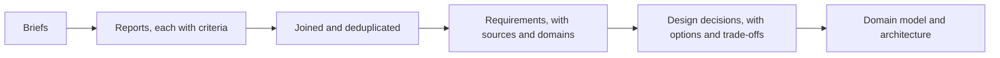

# How the research was done

This page explains the method behind the research in [the research folder](../../research/README.md), and how far to trust it.

## Three rounds

| Round | Question | Reports |
|---|---|---|
| 1 | What does a good project chartering tool hold, including planning ahead and data capture, and how should its documentation work? | [Charter standards](../../research/round-1/charter-standards.md), [planning and data](../../research/round-1/planning-and-data.md), [tools and interface](../../research/round-1/tools-and-ux.md), [Diataxis](../../research/round-1/diataxis-guide.md), [inventory](../../research/round-1/inventory.md), [test script](../../research/round-1/test-script.md) |
| 2 | How do programmes over long horizons, portfolios and large projects with parts differ, and how well does Cartograph serve them? | [Programmes](../../research/round-2/programmes.md), [portfolios](../../research/round-2/portfolios.md), [large projects](../../research/round-2/large-projects.md), [Cartograph's levels](../../research/round-2/cartograph-levels.md) |
| 3 | Setting the current product aside: what should a tool for defining and steering work be, across domains? | [Business case](../../research/round-3/g1-business-case.md), [evaluation](../../research/round-3/g2-evaluation.md), [life cycle](../../research/round-3/g3-life-cycle.md), [first principles](../../research/round-3/g4-first-principles.md), [current state](../../research/round-3/g5-current-state.md), [domains](../../research/round-3/g6-domains.md) |

Each report was written by a separate research agent from a shared brief (kept beside the reports) and a brief of its own. The agents worked apart, so where they agree, the agreement is not an echo.

## Rules the research followed

- **Primary sources first.** Government guidance, standards bodies, funders' own pages and published standards were read at source where they could be fetched, with section or paragraph numbers.
- **Honesty about reach.** Each report opens with how far each source was read, and names what could not be read: most of pmi.org, the ISO texts, the MSP and MoP manuals, parts of the OECD's 2019 text. Where a claim rests on a secondary source, it says so.
- **Across domains.** The owner asked for robustness across domains, so round 3 tested every criterion against sources from several domains and countries, and marked each domain-neutral or specific.
- **Paraphrase.** Sources are summarised, with at most one short quotation each.
- **No scale opinions.** No size or duration is offered as a rule; the sources themselves refuse to give one.

## From reports to requirements

Each report ended in design criteria with their sources. The criteria were joined, duplicates merged, and each written as a requirement that can be checked, with the domains that support it and a priority. Every requirement links back to the report criteria it came from, so any one can be traced to its evidence ([how to trace a requirement](../how-to/trace-a-requirement.md)).

## Limits

- The in-person tests that started this work recorded no data. The requirements about first use rest on that testimony and on design research; they are to be checked with people.
- Research agents can misread a source. The reports name their sources so a reviewer can check any claim.
- The design reflects the sources read. A domain not covered may need something they do not ([how to add a source](../how-to/add-a-source.md)).
