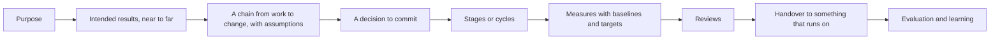
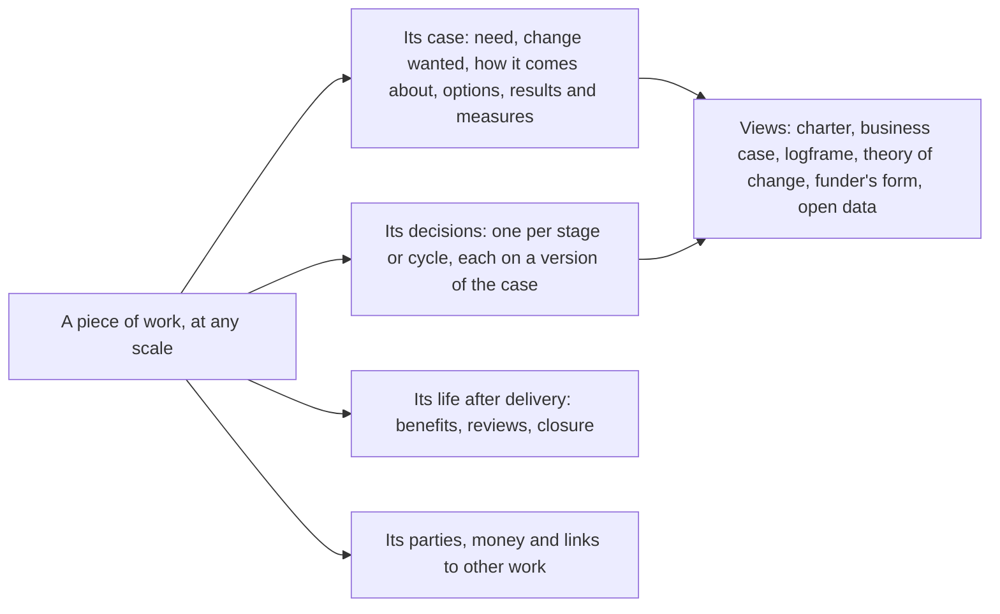

# Why a new model

This page explains the reasoning that led from the research to a new model of the record. The decision itself is [DD-0001](decisions/DD-0001-a-new-model-reusing-only-what-earns-its-place.md); this page is the argument behind it.

## What the research asked

Three rounds of research asked progressively wider questions ([how the research was done](how-the-research-was-done.md)). The first asked what a good project charter holds and how planning ahead and data capture fit. The second asked how programmes, portfolios and large projects differ. The third set aside the current product and asked what a tool for defining and steering work should be, from the frameworks of fourteen domains and from first principles.

## What every domain shares

Every framework read holds the same core, under different names ([round 3, g6 section 3](../../research/round-3/g6-domains.md)):

Alongside run roles and accountability, risks and assumptions, who is affected, money, and where each figure came from.

| Domain | Its words for the work | Its words for the decision |
|---|---|---|
| UK public sector | Project, programme | Strategic outline, outline and full business case |
| International development | Activity, project | Financing decision, board approval |
| Construction | Project | Stage sign-off (RIBA) |
| Software | Product | Sprint planning, portfolio funding |
| Charity | Programme, intervention | Trustee decision |
| Corporate | Objective | Quarterly planning |
| Research | Proposal, grant | Funding decision |

## What differs

What differs is data, not structure: the words, the depth of the results hierarchy, the number and names of stages, who approves, which documents are required, how targets are read, and the reporting calendar ([round 3, g6 section 4](../../research/round-3/g6-domains.md)). A design that builds in one answer serves one domain. This is why [profiles](decisions/DD-0008-profiles-hold-what-differs-between-domains.md) exist.

## How the justification behaves

The Green Book's three business cases, New Zealand's two, the World Bank's concept and appraisal, GOV.UK's discovery, alpha and beta, and RIBA's stages describe one behaviour. The same record becomes more complete, and each step ends in a decision that may be "stop" ([round 3, g1](../../research/round-3/g1-business-case.md), [g3](../../research/round-3/g3-life-cycle.md)). And the work does not end at delivery: benefits are accepted by an owner, tracked, and looked back on.

## Where the current model stands

Read against these findings without loyalty ([round 3, g5](../../research/round-3/g5-current-state.md)), the current Cartograph has a sound platform and a model that fails at its centre:

| Passes | Fails |
|---|---|
| The contract served as data to any interface or agent | Classifying work into one of eight kinds before anything else |
| Storage and identity behind ports with conformance suites | One shape per kind, and a project of 174 fields |
| Changes reviewed before they become the record | "How will we know" asked in seven places, "who" in eight |
| Agents that propose and never write | No decision, stage or review as a record |
| The strategy tree of purpose, goals, gaps and indicators | Methods (DMAIC, control charts, metric expressions) in the core |
| Indicators with readings kept apart | History that restarts when the index is rebuilt |

The failures are not missing fields that could be added. They are the centre: what a person meets first, and what the record is made of. Adding records beside 22 kinds would leave the person still choosing a kind first. That is why the decision is a new model, and why platform parts are kept only where each still earns its place ([reuse candidates](../reference/reuse-candidates.md)).

## The shape of the answer

Each part of that shape is a proposed decision: [one record](decisions/DD-0004-one-record-for-work-at-any-scale.md), [the change first](decisions/DD-0005-the-entry-is-the-change.md), [a case that grows](decisions/DD-0006-the-case-grows-inside-the-record.md), [decisions as records](decisions/DD-0007-decisions-stages-and-reviews-are-records.md), [views as renderings](decisions/DD-0010-views-are-renderings.md).

## What could make this wrong

- If people start more easily from the work than from the change, the entry changes ([DD-0005](decisions/DD-0005-the-entry-is-the-change.md) is conditional on a test).
- If one record cannot express the rules that distinguish a programme from a project without becoming as complex as separate kinds, [DD-0004](decisions/DD-0004-one-record-for-work-at-any-scale.md) must be revisited.
- Several primary sources (the MSP and MoP manuals, PMI's standards, the ISO texts) were read only second-hand.
