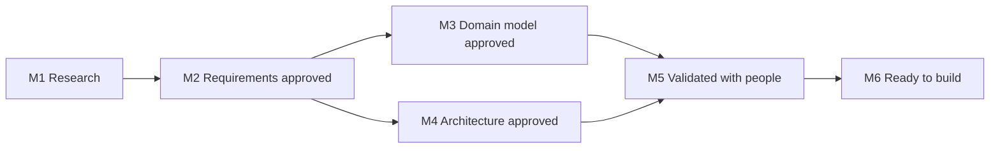

# Design process

How the design is reviewed and approved, the milestones it moves through, and what each status means.

## Milestones

The design is tracked in this repository's [milestones](https://github.com/ProjectCartograph/cartograph-design/milestones). Due dates are targets, moved when the work needs it.

| Milestone | Due | Closes when |
|---|---|---|
| M1 Research | 2026-10-19 | The evidence is complete enough to decide on |
| M2 Requirements approved | 2026-10-30 | Every requirement is Approved, Changed or Dropped |
| M3 Domain model approved | 2026-11-13 | The decisions on the model and the glossary are accepted |
| M4 Architecture approved | 2026-11-20 | The system-level decisions and the component verdicts are accepted |
| M5 Validated with people | 2026-12-04 | The first walk is tested with people, with their use traced |
| M6 Ready to build | 2026-12-11 | The build is planned in the engine and the interface |

## Statuses

| Record | Status | Meaning |
|---|---|---|
| Requirement | Proposed | Written, not yet reviewed |
| | Approved | Accepted as written |
| | Changed | Accepted with new wording, dated and explained in the record |
| | Dropped | Not required, with the reason |
| Decision | Proposed | Written, with its options, awaiting a verdict |
| | Accepted | Decided |
| | Rejected | Not adopted, with the reason |
| | Superseded by DD-NNNN | Replaced by a later decision |

## Who decides

Each requirement area and each proposed decision has an issue. Anyone may comment with evidence or a view; the project's owner gives the verdict, and the record's status changes in the pull request that closes the issue. A requirement priority follows MoSCoW: **Must** for the first stable release, **Should** wanted and may follow, **Could** welcome.
