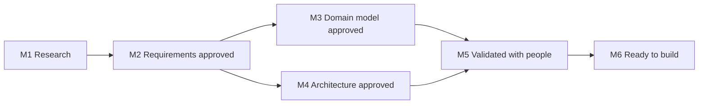
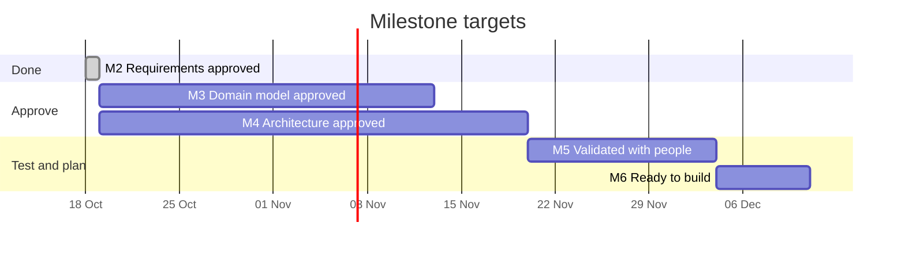

# Design process

How the design is reviewed and approved, the milestones it moves through, and what each status means.

## Milestones

The design is tracked in this repository's [milestones](https://github.com/ProjectCartograph/cartograph-design/milestones). Due dates are targets, moved when the work needs it.

| Milestone | Due | Closes when |
|---|---|---|
| M1 Research | 2026-10-19 | The evidence is complete enough to decide on |
| M2 Requirements approved | 2026-10-30 | Every requirement is Approved, Changed or Dropped |
| M3 Domain model approved | 2026-11-13 | The decisions on the model and the glossary are accepted |
| M4 Architecture approved | 2026-11-20 | The system-level decisions and the component verdicts are accepted |
| M5 Validated with people | 2026-12-04 | The first walk is tested with people, with their use traced |
| M6 Ready to build | 2026-12-11 | The build is planned in the engine and the interface |

## What each milestone settles

| Milestone | Records under review | Also closed in it |
|---|---|---|
| M2 Requirements approved (closed) | All 87 requirements, one issue per [area](requirements/README.md): 72 Must, 15 Should, all Approved | The sources that need a person with access to read |
| M3 Domain model approved | [DD-0004](../explanation/decisions/DD-0004-one-record-for-work-at-any-scale.md), [DD-0006](../explanation/decisions/DD-0006-the-case-grows-inside-the-record.md), [DD-0007](../explanation/decisions/DD-0007-decisions-stages-and-reviews-are-records.md), [DD-0008](../explanation/decisions/DD-0008-profiles-hold-what-differs-between-domains.md), [DD-0012](../explanation/decisions/DD-0012-strategy-is-shared-context.md), [DD-0013](../explanation/decisions/DD-0013-roles-in-the-record-people-outside.md), [DD-0015](../explanation/decisions/DD-0015-bounded-contexts.md) | The [glossary](glossary.md) |
| M4 Architecture approved | [DD-0009](../explanation/decisions/DD-0009-a-small-core-with-extensions.md), [DD-0010](../explanation/decisions/DD-0010-views-are-renderings.md), [DD-0011](../explanation/decisions/DD-0011-documents-with-an-append-only-journal.md), [DD-0014](../explanation/decisions/DD-0014-proposals-saved-straight-in-when-alone.md), [DD-0016](../explanation/decisions/DD-0016-exchange-through-mappings.md), [DD-0017](../explanation/decisions/DD-0017-agents-propose-meaning-behind-a-port.md), [DD-0018](../explanation/decisions/DD-0018-live-co-editing-in-drafts.md) | The verdicts in [existing components](existing-components.md) |
| M5 Validated with people | [DD-0005](../explanation/decisions/DD-0005-the-entry-is-the-change.md), conditional on the test | A change-first entry tested with people, their use traced |
| M6 Ready to build | None | The versioning promise restated for the new model; the build planned in the engine and the interface; their open milestones triaged against the design |

[DD-0001](../explanation/decisions/DD-0001-a-new-model-reusing-only-what-earns-its-place.md), [DD-0002](../explanation/decisions/DD-0002-exploratory-releases-carry-no-promise.md) and [DD-0003](../explanation/decisions/DD-0003-design-approved-before-the-code-changes.md) are Accepted and frame the rest.

## Statuses

| Record | Status | Meaning |
|---|---|---|
| Requirement | Proposed | Written, not yet reviewed |
| | Approved | Accepted as written |
| | Changed | Accepted with new wording, dated and explained in the record |
| | Dropped | Not required, with the reason |
| Decision | Proposed | Written, with its options, awaiting a verdict |
| | Accepted | Decided |
| | Rejected | Not adopted, with the reason |
| | Superseded by DD-NNNN | Replaced by a later decision |

## Who decides

Each requirement area and each proposed decision has an issue. Anyone may comment with evidence or a view; the project's owner gives the verdict, and the record's status changes in the pull request that closes the issue. A requirement priority follows MoSCoW: **Must** for the first stable release, **Should** wanted and may follow, **Could** welcome.
