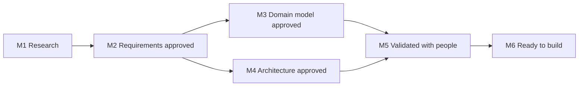

# Milestones

The design is tracked in this repository's [milestones](https://github.com/ProjectCartograph/cartograph-design/milestones), in this order. Each closes when its issues close; the due dates are targets, moved when the work needs it.

| Milestone | Due | Closes when | Holds |
|---|---|---|---|
| M1 Research | 2026-10-19 | The evidence is complete enough to decide on | The three rounds of research; the sources still to read at source |
| M2 Requirements approved | 2026-10-30 | Every requirement is Approved, Changed or Dropped | One issue per area of [the catalogue](requirements/README.md) |
| M3 Domain model approved | 2026-11-13 | The contexts, aggregates, rules and words are agreed | The decisions on the model ([DD-0004](../explanation/decisions/DD-0004-one-record-for-work-at-any-scale.md) to [DD-0008](../explanation/decisions/DD-0008-profiles-hold-what-differs-between-domains.md), [DD-0012](../explanation/decisions/DD-0012-strategy-is-shared-context.md), [DD-0013](../explanation/decisions/DD-0013-roles-in-the-record-people-outside.md), [DD-0015](../explanation/decisions/DD-0015-bounded-contexts.md)) |
| M4 Architecture approved | 2026-11-20 | The system-level decisions are accepted | [DD-0009](../explanation/decisions/DD-0009-a-small-core-with-extensions.md) to [DD-0011](../explanation/decisions/DD-0011-documents-with-an-append-only-journal.md), [DD-0014](../explanation/decisions/DD-0014-proposals-with-a-straight-in-policy.md), [DD-0016](../explanation/decisions/DD-0016-exchange-through-mappings.md) to [DD-0018](../explanation/decisions/DD-0018-live-co-editing-is-not-core.md), and the reuse verdicts |
| M5 Validated with people | 2026-12-04 | The change-first entry and the first walk are tested with people, with the trace on | The prototype test; [DD-0005](../explanation/decisions/DD-0005-the-entry-is-the-change.md) accepted or changed |
| M6 Ready to build | 2026-12-11 | The build is planned in cartograph-engine and cartograph-ui | Implementation issues filed there; their old milestones triaged |
