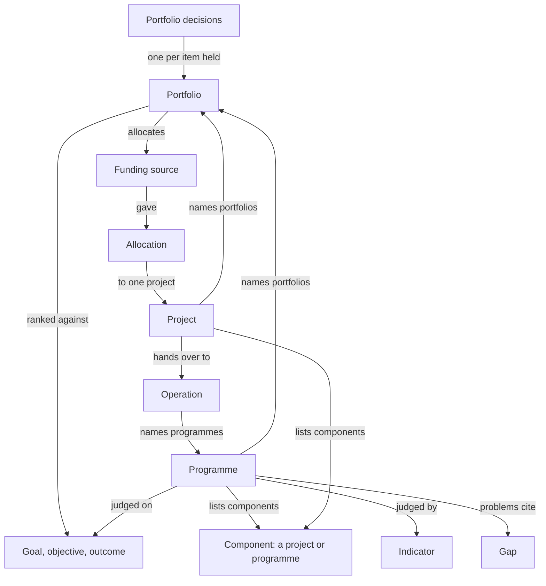

# Cartograph today across the levels, and walk-first

Agent C. Written 2026-10-17. Read-only on both repositories.

## How to read this note

- Every statement about Cartograph names the file it comes from. Paths
  starting `cartograph-engine/` or `cartograph-ui/` are under
  `/home/cascadura/git/project-cartograph/`. Paths starting `guide/` are
  under `.eval/research/guide/`.
- The brief asked for no web research beyond Diátaxis. I fetched these
  Diátaxis pages and read them in full through the fetch tool, which
  returns a summary, not the raw page:
  [start here](https://diataxis.fr/start-here/),
  [tutorials](https://diataxis.fr/tutorials/),
  [how-to guides](https://diataxis.fr/how-to-guides/),
  [reference](https://diataxis.fr/reference/) and
  [explanation](https://diataxis.fr/explanation/). I did not open the
  compass or map pages themselves; the compass is described on start-here.
- **What I could not read at source.** I did not read MSP, PMI, APM,
  PRINCE2 or GovS 002. Where I say what a standard says, I am repeating
  how `cartograph-engine/docs/TAXONOMY.md` quotes it, and I say so. I did
  not read the round-one research files in full, only the guide pages
  under `guide/` and the principles in `tools-and-ux.md` (section B.3).
- **What I did not run.** I did not start the interface, so every
  statement about what a person sees is read from code. The workspace has
  no screenshots of a programme, portfolio or component screen
  (`.eval/audit` and `.eval/audit2` hold project screens only). The
  control counts in section 2 are therefore **inferred from the source,
  not measured**. I did not find the rule the project's screen audit used
  to count a "control in view", so my counts are not comparable with the
  49 and 7 in COMMON.md. They show relative weight only.

---

## 1. How the levels are modelled today

### 1.1 The kinds

| Level | Kind | What it holds | Source |
|---|---|---|---|
| Portfolio | `Portfolio` | Aim (one sentence), strategic objectives (goals or objectives, never outcomes), lead team, budgets (`funding`), review cycle, the portfolios it sits inside | `cartograph-engine/contract/schemas/portfolio.schema.json`; the "never outcomes" rule is in `internal/kinds/portfolio/rules.go` |
| Portfolio's decisions | `PortfolioDecisions` | Per held item: kind, id, priority, decision (invest, hold, stop), reason, date | `contract/schemas/portfoliodecisions.schema.json` |
| Programme | `Programme` | Aim (change and benefit), problems (each citing gaps and groups), risks, sponsor, manager, business change manager, lead and supporting teams, goals, indicators, theory of change (`pathway`), mandate, escalation route, notes, `components`, the programmes and portfolios it sits in | `contract/schemas/programme.schema.json` |
| Project | `Project` | The full charter record, plus `components`, `milestones`, `costs`, `alignment.portfolios` | `contract/schemas/project.schema.json` |
| Operation | `Operation` | A service with no end date; it names its programmes; its running cost has a `per` period | `contract/schemas/operation.schema.json`; TAXONOMY.md D2, D39 |
| Money | `FundingSource`, `Allocation` | A budget with a free-text `period`; what a budget gave one project, with status and decision day | `contract/schemas/fundingsource.schema.json`, `allocation.schema.json`; TAXONOMY.md D7, D69 |

A component is not a kind. It is a project or a programme that another
project or programme lists in its `components` (`Component` in
`common.schema.json`: kind, id, and a short `why`).

### 1.2 How they link

One rule governs every link: the work that depends on something names it,
and the other end is read back (TAXONOMY.md D1, D32, D46). Nothing is
written on both ends.

- **Goals.** A portfolio uses goals and objectives. A programme and a
  project use outcomes (a programme may name an aim at any level; a
  project serves it when one of its outcomes is that aim or beneath it).
  `programme.schema.json` (`goals`), `portfolio.schema.json`
  (`objectives`), engine `programmechecks.go` (`components-serve-outcomes`).
- **Outcomes and a theory of change.** A programme's `pathway` is a set of
  steps, each an outcome (a Goal), the outcomes that must hold before it,
  a `because` and its assumptions. It is a separate set of edges from the
  goal tree on purpose (schema description; TAXONOMY.md D12, D13).
- **Gaps.** A programme's problems cite gaps and say which segments of the
  gap the work reaches.
- **Indicators.** A programme lists the indicators it is judged by. The
  indicator holds its own baseline, target and reading cycle; its readings
  are a separate file (TAXONOMY.md D8).
- **Funding.** A portfolio lists the budgets it allocates. A project's
  cost lines each draw on a funding source, and the budget's holder
  records an `Allocation` to one project. A programme "carries no funding
  of its own" (TAXONOMY.md D39). An operation names the budgets that pay to
  run it, per period.
- **Membership.** A project or programme names the portfolios it is in
  (`alignment.portfolios`, `portfolios`). A sub-programme names its parent
  programme (`programmes`). An operation names its programmes. The parent
  reads these back. Nesting is a tree and a loop is refused
  (`internal/kinds/kit`, called from both rules files).
- **Components (D46).** A project or programme lists what it depends on.
  A component may serve many. The engine resolves the whole graph: every
  path, loops (refused as a blocking check), the critical path and the
  most depended-on work (`internal/engine/components.go`). Older
  declarations (`alignment.partOf`, `alignment.programmes`) are still read
  as components.

### 1.3 What TAXONOMY.md decided, and why

All from `cartograph-engine/docs/TAXONOMY.md`. It states the discipline
by quoting APM and PMI; I have not checked those sources myself.

- **D1, D46: membership is declared by the work, and the structure is a
  graph.** A programme is edited never to gain a member. Why: one place to
  change a link, and shared enabling work (a data platform) is a component
  of each project that uses it.
- **D3, then D32: a portfolio is a kind.** D3 left it out on purpose. D32
  added it because Cartograph had nowhere to hold the decision a portfolio
  exists to make: what to fund, in what order, what to stop.
- **D32: three constructs told apart by purpose.** A portfolio is selected
  and prioritised against strategy, with no causal link needed between its
  contents. A programme coordinates related work to bring about one change,
  and a theory of change is what makes it one. A project delivers. A
  grouping that is none of these is a collection, "not a kind".
- **D32: a programme without a pathway is advised, not refused.** The
  advice says it may be a portfolio (`pathway-steps` check).
- **D4: no Benefit kind.** A benefit is a goal, a key result, an
  indicator and a beneficiary group together. Benefits realised would be
  readings against indicators, not a new noun.
- **D5, D32: sub-programmes exist** (`Programme.spec.programmes`).
- **Mapping table: "Tranche" has no home.** TAXONOMY.md says a tranche is
  "scheduling, which belongs to the delivery tool" (line 101).
- **D6: a programme's and a portfolio's checks only advise.** Their
  answers come from other records, so none can stop a save
  (`programmechecks.go`, `portfoliochecks.go`).
- **D54 (quoted in TAXONOMY.md near line 1540): a project has one
  objective.** A second is a blocking check. Anything else that needs its
  own objective is a project of its own, listed as a component. This is
  the rule that makes "split a large project" a real step, not a choice.
- **D56: the structure is decided first** by ordered questions that every
  person and agent answers the same way (`GET /structure`). The UI shows
  them as the "Which describes it best?" dialog.
- **D55: the charter is a brief.** It prints what a sponsor approves; the
  rest is counted and stays in Cartograph.

### 1.4 What each charter prints

Only a programme, a project and an operation render a document. I found
no render function for a portfolio: `internal/render` has
`ProgrammeCharter`, `charter_project.go`, `operation.go` and nothing for
`Portfolio` (a search of the package for "portfolio" finds none outside
tests). In the interface, the charter button is mapped to Programme and
Operation only (`cartograph-ui/src/definition/Shell.tsx`,
`CHARTER_ROUTE`).

**Programme charter** (`cartograph-engine/internal/render/programme.go`),
in order: a control block (reference, sponsor, manager, readiness word);
contents; At a glance (the change as a lead sentence, then sponsor,
programme manager, business change manager, lead team, a component count,
goals, source, and readiness by area); Aim (Intended change, Benefit);
Problems; Benefits (the goals, then a table of indicator, baseline,
target, data source, frequency); Theory of change (printed outcome first,
then preconditions and assumptions); Components and dependencies (a
diagram, a table of component, type and sub-components, and a "Critical
path" line with months); Risks; Governance (teams, escalation route,
mandate, stakeholders); sign-off; version history.

It prints **no schedule, no budget and no phases**. The code and the
schema agree: a programme has no dates of its own.

**Project charter with components**
(`internal/render/charter_project.go`, `brief.go`): the brief form of D55.
When a project lists components or is used by others, it adds
"Components and critical path": the dependency diagram and the critical
path line. Its Budget field adds its components' cost lines: "X with its
components (Y its own)" (`budgetWithComponents` in `brief.go`). Its
schedule comes from milestones.

Two things I could not settle from code alone:

- `criticalLine` prints the critical path of the **whole workspace
  graph**, not the chain through this project. In a workspace with
  several unrelated parents, a project's charter may print a chain it is
  not in. I did not run it to see.
- `budgetWithComponents` adds only components that are projects (it reads
  `Project` costs). A programme component adds nothing to a project's
  budget line.

### 1.5 The words a person meets

`cartograph-engine/contract/guidance/en/programme.guidance.json` defines a
programme as related projects and smaller programmes "run together to
bring about one change", and says it is not a portfolio, a project, an
operation or a goal. `portfolio.guidance.json` defines a portfolio as work
your organisation "ranks and decides whether to fund", and says it is not
a programme, a project or a collection. The `knownAs` lists give the
words people bring (flagship, strategic programme, investment portfolio,
pipeline). The example workspace
(`cartograph-engine/examples/minimal`) has two programmes, one portfolio
with decisions (invest in the Quality Improvement Programme, hold the
Market Access Programme), one project, one budget and one allocation.

---

## 2. Every screen and walk

### 2.1 The routes

From `cartograph-ui/src/routes`:

- `/programmes` (a file-explorer list with a **New programme** button),
  `/programmes/new` (name and lead team), `/programmes/prepare`, then
  `/programmes/$id/` which redirects to `aim`. Eight steps:
  `aim`, `problems`, `alignment`, `pathway` (Theory of change), `risks`,
  `components`, `stakeholders`, `teams` (Governance). Two more pages,
  `charter` and `framework` (the results framework, derived), open from
  buttons in the step header.
- `/portfolios` (list), `/portfolios/new`, `/portfolios/prepare`, then
  `/portfolios/$id/` which redirects to `aim`. Four steps: `aim`,
  `strategy`, `holds` (titled **Contents**), `governance`. No charter, no
  framework page.
- Components have no route of their own. A component is a project. It is
  listed from a parent's **Alignment** step (project) or **Components**
  step (programme), with the table in
  `cartograph-ui/src/projects/components/ComponentsTable.tsx`.

### 2.2 How a person arrives

Three doors reach "make a programme" or "make a portfolio":

1. **Home**: type a sentence; the engine suggests flows; `flowLink` in
   `surfaces/home/flows.ts` sends the stage `programme` or `portfolio`
   straight to `/programmes/new` or `/portfolios/new` with the typed text
   as the name.
2. **Create menu** or **New**: **Not sure which?** opens
   `components/WhichKind.tsx`, a list of ordered questions (eight tiles:
   run by another body, a standing policy, a service, a portfolio, a
   programme, a deliverable, a component project, a project). The
   portfolio and programme tiles go to `/portfolios/prepare` and
   `/programmes/prepare`.
3. **The rail**: **Programmes** or **Portfolios**, then the new button.

The **Prepare** page (`projects/Prepare.tsx`) sits between the choice and
the walk. Its rows come from each flow's `prepare` list: a programme has
nine (Team, Resource, Goal at outcome level, Segment, BeneficiaryGroup,
KPI, Gap, Assumption, Portfolio), a portfolio four (Team, Goal, Funding
source, Reporting cycle), a project fifteen
(`contract/flows/*.flow.json`). Copy says "You can skip any of it and
start at any time." (`copy.prepare.subtitle`).

### 2.3 Programme walk, step by step

All eight steps share one frame (`definition/Shell.tsx`): a title, header
buttons (**Charter**, **Results framework**, **Show in graph**), a save
status, a scrubber of eight marks coloured by the programme's checks, the
step, a notes box, a checks panel, then **Back** and a **Next to ...**
button. Steps autosave (`useSectionAutosave`); there is no Save button.

| Step | What the body shows (from `cartograph-ui/src/programmes/sections`) | Inferred controls in the body |
|---|---|---|
| New | Name, lead team, **Start** | 3 |
| Aim | Name, reference, Intended change, Benefit, Source | 5 |
| Problems | One card per problem: groups, situation, cause, the change, benefit, cited gaps with segments; **Add a problem** | about 10 for an open card, plus 1 |
| Alignment | Outcome chips (search, suggestions, one chip per outcome in the workspace); Indicator chips (group-by select, search, add, one chip per indicator); Part of programmes; Portfolios | 6 fixed, plus one chip per outcome and indicator |
| Theory of change | One card per step: remove, outcome, because, assumptions with add, "Also needs" reveal, add precondition; **Add another outcome** | about 7 per card, plus 1 |
| Risks | A risk matrix and a list; per risk about ten fields (type, description, impact, likelihood, mitigation, owner, escalate, depends) | about 10 per risk, plus the matrix |
| Components | A filter box, a four-way show toggle, three sort headers, a table row for every project and programme in the workspace (a checkbox and a "what this needs" box each), a "Used by" list, an "inside" list with a link per member, a "Related work" list with a link per candidate | about 9 fixed, plus 1 to 2 per row |
| Stakeholders | A stakeholder grid (a second record, saved separately) | about 18 sites in the source |
| Governance | Sponsor, Programme manager, Business change manager, Lead team, Supporting teams, Escalation route | about 7 |

**Chrome around every step** (header buttons 3, scrubber marks 8,
**Back** and **Next** 2, the notes box and checks panel about 2): about
15 controls, before any body. The global rail and the **Create** button
come on top of that; I did not count them. Of these, one is the
primary action (**Next**). Adds (**Add a problem**, **Add another
outcome**) are secondary.

Reading this against the audit's median of 49 controls and 2 to 3
primary actions: the Aim, Governance and Alignment steps, with chrome,
sit between about 20 and 25 controls. Theory of change with four steps
sits near 45. Components in a workspace of 30 projects and programmes
sits near 60 or more. These are my estimates from reading the code, and
the audit method may count differently.

### 2.4 Portfolio walk, step by step

Same shell (`portfolios/StepPage.tsx` uses `DefinitionShell`), with these
differences from a programme:

- The header shows only **Show in graph**. **Charter** and **Results
  framework** are mapped to Programme (and Operation) only.
- The scrubber has four marks. They are **not coloured by checks**: the
  shell reads check states only for Programme, Operation and Gap
  (`Shell.tsx`, `isProgramme`, `isOperation`, `isGap`). A portfolio has
  checks, and a panel lists them, but the rail does not show them.

| Step | Body | Inferred controls |
|---|---|---|
| New | Name, "Governed by", **Create** | 3 |
| Aim | Name, "What it invests in, and why" | 2 |
| Strategy | Suggestions and chips for goals and objectives (outcomes cannot be picked) | 2 fixed, plus one chip per goal and objective |
| Contents | Read back from what names the portfolio. Per item held: a three-way **Invest / Hold / Stop**, a **Priority** number, a **Reason** box, and a link to the item. One **Save decisions** button for all | 5 per item, plus 1 |
| Governance | Governed by, Budgets, Review cycle, Part of | 4 |

Chrome: about 9. **Contents** is the one step in either walk with its own
save button; every other step autosaves. The decisions are written as one
review (`HoldsSection.tsx`: it saves a `PortfolioDecisions` file named
`<portfolio>-decisions` with the reason "Portfolio review", and stamps
today's date on each line that was changed).

With six items held, the Contents step shows about 30 controls plus
chrome. For a portfolio of fifty items it would show about 250 in one
scroll; I did not test it.

### 2.5 Components

- **From a project:** the **Alignment** step (stage Context) asks "Does
  this project have any dependencies?" (`copy.projects.components.ask`)
  and opens the same table as the programme's. A "Used by" row reads back
  what depends on this project. Source:
  `projects/sections/GoalsSection.tsx`, `projects/components/`.
- **Making a new one:** the which-kind tile "A component project" goes to
  `/projects/start` with no extra context (`WhichKind.tsx`, `TILE
  .changeOfItsOwn`). The project walk can ask "Parent project" first, but
  only when the route is opened with `partOf` set. The only place I found
  that sets it is the Prepare page, and nothing I found links to
  `/projects/prepare?partOf=true`. The copy "Start a component"
  (`copy.projects.newProject.componentTitle`) is not used anywhere.
- **What it writes:** that parent question stores `alignment.partOf`
  (`projects/start/StartProject.tsx`, lines 185 and 204). D46 calls that
  an older declaration and says "the editor writes only `components`".
  The engine still reads it, so nothing breaks, but the two disagree.
- **Dependencies and the critical path** appear in the table as marks (in
  a loop, on the critical path, most depended on) and in the charter.

### 2.6 Where a person would get lost

All inferred from code; none observed.

1. **A cascade before the first question.** Through "Not sure which?" a
   person meets a dialog of eight tiles, then a page of nine
   things to prepare, then a name and team page, and only then the Aim
   step. The test finding was that people gave up at the first screen
   after setup. Home's direct route skips two of these.
2. **The walk is longer than its flow.** The engine flow
   (`contract/flows/programme.flow.json`) has seven steps in the order
   aim, problems, alignment, components, pathway, risks, governance. The
   interface has eight, in the order aim, problems, alignment, theory of
   change, risks, components, stakeholders, governance. The UI puts the
   theory of change before components (the engine flow does the reverse),
   and adds stakeholders. A guide page that follows one will not match
   the other.
3. **Two lists on one Components step.** The top table is what the
   programme depends on, stored on the programme. The list below is
   "inside" the programme, read back from projects and operations that
   name it, and its hint says "open it and choose this programme"
   (`copy.programmes.insideHint`). For projects that is the older
   declaration. A person who adds a project in the table may not see it
   in the lower list. I did not run it to confirm.
4. **No dates anywhere on a programme.** A person used to a programme plan
   looks for phases, years and tranches and finds none (section 3).
5. **A portfolio cannot add its own contents.** The empty state says "To
   add one, open it and choose this portfolio under Portfolios"
   (`copy.portfolios.holdsEmpty`). The person must leave the portfolio
   and edit each project or programme.
6. **Decisions need all of it on one page.** Every item held has five
   controls on the same page, and no step explains what "hold" means
   beyond the schema text.
7. **No printed portfolio.** The sponsor asked "what did we decide, and
   why?" has no document to hold, though the programme and the project do.
8. **The rail does not show portfolio progress.** Four steps, none marked
   done or advised.
9. **Splitting a project is hidden.** A second objective is a blocking
   check, and the fix is a component. The check names the rule; the
   path to a new component project is not linked (2.5).
10. **A whole-workspace table.** The component table lists every project
    and programme. A workspace of any size makes that the largest control
    count on any screen.

---

## 3. Long horizons in the data

### 3.1 What exists

| Thing | Where it is dated | Source |
|---|---|---|
| An aim (goal, objective, outcome) | `horizon`: start and end, each a year or a year and month. An objective or outcome without one takes its parent's. A check flags a child that runs past its parent. | `goal.schema.json`; `common.schema.json` `Horizon`; TAXONOMY.md D26 |
| A target or baseline | A `Target` is a value by a date, a value due at a timing, or a value to be set when an event happens. | `common.schema.json` `Target`; D47 |
| Any "when" | A `Timing` in one of four forms: a date (month or day), a window (not before, not after, or both), after an event with a lag in months or days, or set when an event happens with a month it is expected by. A timing may name the risks that could move it. | `common.schema.json` `Timing`, `Event`; D47 |
| A reading | One value per period; the period is the month or day it ends. The series grows without end and each reading is kept as its own record. | `kpireadings.schema.json`; D8 |
| A reporting cycle | Equal months (1, 3, 6, 12), equal days (1, 7, 14), or named periods that repeat each year or happen once. | `reportingcycle.schema.json`; D40, D68 |
| A project's schedule | Milestones, each with a timing, owner, deliverables and evidence, linked finish to start. Phases still read but are deprecated and limited to 60 months each. | `project.schema.json`; D48 |
| A funding source | `period`, free text ("a financial year, a season, a grant term"). | `fundingsource.schema.json` |
| An allocation | An amount, a status, and a day it was decided. No period of its own. | `allocation.schema.json` |
| A service's running cost | A line with `per`: month or year. | D39 |
| A portfolio's review | A reporting cycle (`reviewCycle`), and a decision's `decidedOn`. | `portfolio.schema.json`, `portfoliodecisions.schema.json` |

TAXONOMY.md deliberately names no length for a horizon (D26 says it
"suggests no length", and notes Cartograph is used from a national plan to
a club's year). Nothing in the schemas or checks caps a horizon, a target
date or a series.

### 3.2 Can a programme say tranches or phases over years?

**Not on the programme, by design.** `programme.schema.json` has no
timeline, no milestones, no phases and no timing. D46 says "a programme
has no dates of its own". The mapping table says a tranche belongs to the
delivery tool. `internal/kinds/programme/rules.go` runs the risk rules
"without phases ... because a programme holds no timeline".

What a person can say instead, using what exists:

- **Stages as outcomes with horizons.** Each pathway step is an outcome,
  and an outcome carries a `horizon` in years. A programme whose change
  arrives in stages can write one outcome per stage, each with its own
  horizon, and the pathway says which must hold before which. This is the
  closest fit and it uses nothing new. The weakness: the horizon sits on
  the goal, which "outlives any one programme's theory", so two programmes
  sharing an outcome share its dates.
- **Stages as components.** Each stage is a project, listed as a component
  with a `why`. Its own milestones carry dates and waits. The engine finds
  the critical path across them and the programme charter prints the line
  with a month count.
- **Waits between stages.** A project's milestone can wait on an event in
  another project (`Event` with `item` and `on`, D47). That is how stage
  two starts "after stage one's baseline is accepted". The engine refuses
  a loop of waits.
- **A target that cannot be set yet.** "Set when" with an expected month
  records a target that waits on a baseline, and flags it if the month
  passes (D47).

What it cannot say today:

- A named tranche or phase on a programme, with its own scope, funding and
  review date, that is not an outcome or a project.
- A programme-level view over time. The critical path is a single longest
  chain, and the charter line prints a month count only
  (`internal/render/brief.go`, `criticalLine`).
- Commitment by period: a funding source has a free-text `period`, an
  allocation has one amount for one project, and a decision has no span.
  So "approved for the first three years, the rest subject to review" has
  no field. A person could split it into two allocations on two funding
  sources, one per period; nothing in Cartograph would tie them together.
- A risk's `needBy` on a programme. The schema copies the field from the
  project, but the programme rules run without phases, so it has no phase
  to land by. I did not test what happens if one is written.

### 3.3 Readings and targets across years

- A KPI is defined once; its readings are one file that grows (D8). Cost
  of recording a reading does not rise with the length of the series (the
  note on ADR 0013 in D8).
- A target is a value and a date, or a timing. A series of targets by
  year (for a multi-year programme) is not a field: a KPI has one
  `target`. I read `kpi.schema.json` for `baseline`, `target`, `cycle` and
  found no list of interim targets. A programme that wants "38 now, 50 in
  year three, 60 in year six" can say it by listing three indicators or
  by writing the later values in words. I did not search the engine for a
  trajectory feature; the schema has none.
- A named-period cycle can follow a school year or a survey wave and
  repeat each year, so a long series stays tied to the calendar a field
  uses (D40).
- Goals nest horizons (a child may not run past its parent), so a long
  programme's outcomes can sit inside a longer strategy.
- Nothing aggregates readings up the levels. A programme lists
  indicators; it does not roll up its projects' key results. The results
  framework page (`cartograph-ui/src/framework/derive.ts`) derives a
  matrix from a programme's pathway, indicators and components, and holds
  nothing of its own.

### 3.4 Money over years

- A project's cost plan is lines against funding sources; allocations come
  from the holder. A check says the lines on one source may not exceed its
  allocation to that project (D69).
- A project's charter adds its components' cost lines into its Budget.
- A programme's charter prints no budget (the programme has no funding).
  A programme's cost is therefore the sum of its component projects'
  allocations, and no screen adds that up. I did not find a roll-up in the
  UI or the render code.
- A portfolio lists budgets it allocates; no screen shows what is left in
  them or what has been allocated against them. The `Allocation` kind is
  edited as a sheet (`surfaces/sheet/schema.ts`); the project's plan
  registers read it back (`projects/allocations.ts`).

---

## 4. Walk-first at these levels

### 4.1 Principles applied

From `.eval/research/tools-and-ux.md` section B.3, each with its source
there:

- One question per page, the question as the heading
  ([GOV.UK question pages](https://design-system.service.gov.uk/patterns/question-pages/)).
- A way back on every page and "I'm not sure" where it is a valid answer.
- Ask only what is needed now; defer the rest; say why you ask.
- Never ask twice: carry answers forward.
- Help sits beside the question, in plain words.
- Name the section above the question; no long progress bar until tested.
- Save as you go; Home shows the unfinished walk.
- A longer job done over several sittings gets a short task list with
  verbs and two states
  ([GOV.UK task list](https://design-system.service.gov.uk/patterns/complete-multiple-tasks/)).
- End on one review page, grouped, with a change link beside each answer
  ([GOV.UK check answers](https://design-system.service.gov.uk/patterns/check-answers/)).
- Two levels at most: the walk, and the full workspace one visible step
  away ([NN/g, progressive disclosure](https://www.nngroup.com/articles/progressive-disclosure/)).

Diátaxis lens: a walk is shaped like a tutorial (one route, a small
result at each step, a supportive voice) that ends in real work
([tutorials](https://diataxis.fr/tutorials/)). The pages around a walk are
how-to (the goal), reference (every field) and explanation (why a
programme is not a portfolio). A walk page holds none of those; it links
out.

Two limits from the same sources. NN/g says a linear sequence suits steps
with little interaction and fails when steps depend on each other. A
theory of change is the hardest case here: each step depends on the one
before. The walk must show what has been said so far beside the question.
And a walk through many items (decisions on a portfolio) is a loop, not a
line; it needs a stated place to stop.

Question wording below uses Cartograph's own words. The examples use the
produce cooperative (`cartograph-engine/examples/minimal`) and its real
record names. Where a name does not exist there, I mark it **(new)**.

### 4.2 Define a programme

**Before the walk (one page, not nine).** Ask the D32 question that
decides whether it is a programme: "Does each piece of work need the
others to bring about the same change?" If no, offer the portfolio walk.
This is the first of the engine's `/structure` questions, asked once, in
place of a list of eight tiles. Do not open the Prepare page. Create
anything the walk needs where the question asks for it (the existing
`SheetAddDialog` and `KPIAddDialog` pickers already do this), which keeps
"never a gate" from D34.

**Stage 1: The change** (aim)

1. *What will be different when this programme has worked?* Intended
   change. Example: "Every depot checks produce against one published
   standard." Hint: the state, not the work.
2. *Who is better off, and how?* Benefit. "I'm not sure" is valid
   (optional in the schema).
3. *What should we call it?* Name. Offer the typed idea first.
4. *Is it written down somewhere?* Source. Optional.

**Stage 2: What is wrong** (problems; one problem at a time)

5. *Who is affected?* Groups.
6. *What can they not do today?* Situation.
7. *Which gap shows it?* Pick or add a gap; say which segments the work
   reaches.
8. *Is there another problem?* Yes loops to 5; No continues.

**Stage 3: How you will know** (alignment)

9. *Which outcomes is this programme for?* Outcomes. If none exist,
   say so and offer to write one first (the order of work puts goals before
   programmes).
10. *Which indicator will you watch?* Indicators. The reading cycle and
    target belong to the indicator and are asked there; do not ask again.
11. *By when should each outcome hold?* Writes the outcome's horizon, as
    years. One page per outcome, skippable. It lands on the goal, not the
    programme, so say so beside the question.

**Stage 4: How the change happens** (theory of change; a loop)

12. *Which outcome is the end of the chain?* Pick the outcome. Shown:
    nothing yet.
13. *What has to be true just before that?* Pick or add an outcome.
14. *Why does that lead to it?* Because. The page shows the chain so far.
15. *What are you assuming?* Assumptions. Optional.
16. *Is that something one of your projects does?* Yes ends the branch.
    No returns to 13 for that outcome.

**Stage 5: The work** (components)

17. *Which projects or programmes does this programme need?* The table,
    reduced to a short picker of what exists, with a filter. For each:
    *What does this programme need from it?* (the `why`).
18. *Does anything it needs not exist yet?* Starts the project walk or
    component walk (4.4) and returns here. Never leaves the programme
    half-listed.
19. *Which services does it rely on, or set up?* Operations name the
    programme; offer the link from here.

**Stage 6: Who answers for it** (governance)

20. *Who is accountable for the benefits?* Sponsor.
21. *Who runs it day to day?* Programme manager.
22. *Who makes the change stick once projects hand over?* Business change
    manager. "I'm not sure" valid.
23. *Which team leads it, and which teams support it?*
24. *If it cannot be settled here, who decides?* Escalation route.

**Stage 7: What could stop it** (risks) and **who matters** (stakeholders).
Both optional, both loops, both after the core.

**Review page.** Grouped by the stages above, a change link by each
answer, an empty line reads "Not provided". The button reads **Create the
programme charter**, which is what it does. The page shows the checks that
matter now: no theory of change (the portfolio hint), no component, no
outcome.

Where the walk touches other kinds, it writes them in the same change set
and says so. That keeps D28's order: outcomes and gaps are written before
the programme names them.

### 4.3 Set up a portfolio and decide what it funds

Two walks, not one. Defining the portfolio is done once. Deciding is done
at every review. Round-one principle: a task done over several sittings
is a short list, not a long line.

**Walk A: Set up a portfolio**

1. *What does this portfolio fund, and why?* Aim, one sentence. Example:
   "Fund first the work that most raises what members earn from each
   season's produce."
2. *Which goals or objectives do you weigh the work against?* Strategic
   objectives. Say outcomes are not offered, and why, in one line.
3. *Which team decides what is funded?* Lead team.
4. *Which budgets does it hand out?* Funding sources. Optional.
5. *How often do you review it?* Review cycle. Optional. "I'm not sure"
   valid.
6. *Is it part of a larger portfolio?* Part of. Optional.
7. *Which programmes and projects are in it?* A picker of what exists.
   Choosing writes the portfolio onto each item (the declaration lives
   there), in the same change set. This replaces the instruction to go and
   open each item.
8. Review page; button **Create the portfolio**.

**Walk B: Review a portfolio** (a task a person returns to)

Opens from a portfolio, and from Home when the review cycle says one is
due (a prompt for this does not exist today; see section 5). One item per
page, in the portfolio's current priority order.

1. *Invest, hold or stop the Quality Improvement Programme?* Three large
   choices, each with the schema's meaning in one line (invest: fund it
   and let it go on; hold: commit nothing more until reviewed again; stop:
   end it and release what it holds). The page shows its outcome and last
   indicator reading beside the question, so the person is not deciding
   blind.
2. *Why?* Reason. Prefilled with the last reason when the decision has not
   changed.
3. *What is its rank?* Priority. "Same as before" is the default.
4. If invest: *How much does a budget give it?* Pick the budget and the
   amount. This writes an Allocation, which today is a sheet edited
   somewhere else. Offered only for a project, because an allocation
   names a project; for a programme, offer its component projects.
5. *Next item.* After the last: the review page, sorted by priority,
   with a change link each. The button reads **Record this review**.

The existing single Contents page stays as the one-step-away full view.

**What the walk cannot do yet:** show what is left in a budget; print the
decisions as a document; keep an earlier review readable as a list (the
file is one per portfolio, and earlier reviews are versions in history).

### 4.4 Split a large project into sub-projects

The trigger is a rule, not a choice: a project has one objective, and a
second one is a blocking check (TAXONOMY.md D54). Everything else a large
project wants to hold separately is a component. The walk starts from a
project and asks.

1. *Is there a part of this project that makes a change of its own?*
   The test, in the words of D49 and D56: it has its own lead, its own
   dates or its own risks, or other work depends on it. Plain examples. If
   the part only hands something over, it is a deliverable; the walk says
   so and returns.
2. *What is true once that part is done?* The part's one objective. Hint:
   the state, as for a programme's aim.
3. *What is it called?*
4. *Which team leads it?* Carry the parent's team as the default.
5. *When does it start and finish?* The four timing forms in plain words:
   on a date; between two dates; after something else happens; set when
   something happens. Pick one; "I'm not sure" valid, with a month by
   which it will be known.
6. *Does it wait on anything?* Another part's milestone, or something
   outside. A loop is refused with the chain named, on this page.
7. *What does the whole project need from it?* The `why`.
8. *Does anything else use it?* Shows what already lists it, if the part
   exists. Otherwise skipped.
9. *What could go wrong with it?* Optional.
10. *Another part?* Loops to 1.
11. Review page. It shows the parts as the dependency diagram and says the
    critical path in plain words, with any loop. The button reads **Add
    these parts**.

What carries over and is never asked again: the parent's programme, the
outcomes it serves, its funding sources, its stakeholders. Each part then
continues in the ordinary project walk, which starts with its answers
already there.

Notes for the walk's build, from the code:

- It should write the parent's `components` and not `alignment.partOf`
  (D46).
- It should be linked from the "A component project" tile and from the
  parent's Alignment step. Today neither is (2.5).
- Cartograph does not reschedule on its own (D48), so a conflict between a
  part's dates and the parent's is shown and the person decides.

---

## 5. The guide's gaps for these users

What exists (under `guide/`): one tutorial (charter your first project),
20 how-to pages (none for a programme, a portfolio or a component),
two reference pages, eight explanation pages. A search of the guide for
"programme", "portfolio" and "component" finds the words in
`reference/kinds-of-record.md` (one entry each), a line in
`explanation/about-purpose-goals-objectives-and-outcomes.md`, a line in
`explanation/about-checks.md`, and nowhere else. No page says how to
make, decide with or read any of them.

### 5.1 Existing pages that need sections

| Page | What to add |
|---|---|
| `guide/README.md` | A new group of doors: "If you plan a programme or a portfolio", and one for large projects. |
| `guide/reference/kinds-of-record.md` | Portfolio entry says the page is "Holds"; the heading on screen is "Contents". Programme entry lists eight pages in the interface order, which differs from the contract's flow (2.6). The Portfolio decisions example says "hold the member app until its pilot reports", but the shipped example holds the Market Access Programme. Add Allocation and Funding source to the portfolio entry's links. Say what a component is, and that it is not a kind. |
| `guide/explanation/about-purpose-goals-objectives-and-outcomes.md` | A short section on how the means differ in level (portfolio, programme, project), pointing to the new "About programmes, portfolios and projects". |
| `guide/explanation/about-project-charters.md` | A section on the charter at programme level: what it prints, and that it prints no dates or budget. |
| `guide/explanation/about-planning-ahead.md` | A section on long horizons: where a date lives at each level (section 3). |
| `guide/explanation/about-checks.md` | Add the portfolio's three checks; the programme paragraph exists. |
| `guide/explanation/about-walk-first.md` | Say how walk-first applies to a loop (a theory of change, a review) and to a long job over several sittings. |
| `guide/explanation/about-change-sets.md` | A line on why a walk that edits several records (a portfolio and each member) lands as one change set. |
| `guide/how-to/export-the-charter.md` and `edit-the-charter-where-you-read-it.md` | Check whether they cover a programme charter; the interface allows it. |
| `guide/WRITING.md` | The running example has one programme and one project. Add the pieces the new pages need to the cooperative's example, and say which are new. |

### 5.2 New pages

**Tutorials** (one route, no choices, a result at each step)

- *Define your first programme*: the cooperative's Quality Improvement
  Programme, from aim to a printed programme charter.
- *Set up a portfolio and make a first decision*: the Cooperative
  Investment Portfolio, ending on a saved decision.

**How-to guides** (one goal each)

- *Start a programme*: for someone who knows what it is for.
- *Write a programme's theory of change*: add a step, add what comes
  before it, and say why.
- *Add a project or programme as a component*: list a dependency and say
  what you need from it.
- *Split a large project into components*.
- *Add a sub-programme to a programme*.
- *Put a project or programme in a portfolio*.
- *Set up a portfolio*.
- *Review a portfolio and record the decisions*.
- *Record what a budget has allocated to a project*.
- *Find the critical path and fix a loop of components*.
- *Read the results framework of a programme*.
- *Export a programme charter*.
- *Say that a target will be set later* (a timing "set when", with the
  month it is expected by).
- *Show a programme's change arriving in stages*: one outcome per stage,
  each with a horizon, and the projects that deliver each.
- *Choose between a programme and a portfolio* is **not** a how-to; see
  the explanation below.

**Reference**

- *Programme and portfolio fields*: every field of the two kinds and of
  `PortfolioDecisions`, in the order of the screens, the same parts for
  each entry.
- *Timing forms*: the four, their fields, what an event is, and where each
  can be used.
- *Checks on programmes and portfolios*: each check id, the step it sits
  on, what it says, and why it only advises.
- *Component marks*: in a loop, on the critical path, most depended on.

**Explanation** ("About ...")

- *About programmes, portfolios and projects*: three constructs told apart
  by purpose, the D32 questions, and where Cartograph departs from the
  standards. Cite MSP, PMI and APM through the pages the team can read
  (see open questions).
- *About components*: why work lists what it depends on and not what it
  contains, why shared work is a component of each user, why a project has
  one objective.
- *About theory of change*: backwards mapping, why each step needs a
  because, why it is not the goal tree.
- *About long horizons*: why a programme has no dates of its own, what
  stands in for them, and the cost of that choice.
- *About portfolio decisions*: invest, hold and stop; why decisions are
  their own file; what a review is.
- *About money across levels*: funding source, allocation, cost plan, and
  why a programme has no budget.

### 5.3 Order to write them

1. *About programmes, portfolios and projects* (the other pages link to
   it).
2. *Define your first programme*, because the programme is the level
   people said they use for long horizons.
3. *Set up a portfolio* and *Review a portfolio and record the decisions*.
4. *Split a large project into components* and *Add a project or
   programme as a component*.
5. The references, once the interface order and the contract order agree
   (section 2.6, point 2).

The guide's rule is to grow one page at a time and to leave out any step
that cannot be confirmed from the code (`guide/WRITING.md`,
`.eval/research/WRITE-RULES.md`). Three of the how-to guides above depend
on screens that do not exist yet (a review walk, a start-a-component
link, a portfolio roll-up). Write those after the screens, or say plainly
what the screen does today.

---

## Open questions

1. Do the programme and portfolio screens look as heavy as my counts say?
   Nobody has measured them. A fresh pass of the screen audit, with
   programme, portfolio and component screens added, would settle section
   2 and give a figure that compares with the 49 and 7.
2. What counting rule did the project's audit use, and does it count the
   rail and the Create button? I could not find it.
3. Does a project's Components step show a project the programme lists in
   its table, in the lower "inside" list? The code suggests not (2.6,
   point 3). It needs a run.
4. Does `criticalLine` print a chain the project is not in? The code reads
   the whole workspace graph (1.4).
5. Is the start-a-component path reachable by a person? I found no link to
   it (2.5). If it is not, how is the "A component project" tile meant to
   work?
6. Should the interface walk and the engine flow for a programme be the
   same list? They differ in count and order (2.6, point 2). The guide
   must follow one.
7. Where should a programme's dated stages live? Section 3.2 gives
   outcome horizons and component projects as stand-ins. Whether that is
   enough for people who plan over decades is a question for the people
   who use it that way.
8. Is a series of interim targets for one indicator wanted? The schema has
   one `target`. I found no feature for a series.
9. Does a portfolio need a printed document? I found none; the sponsor
   case in section 2.6, point 7 is my inference.
10. Should a review of a portfolio be prompted when its cycle says it is
    due? I found no such prompt, and no list of past reviews other than
    file versions.
11. MSP, PMI, APM and GovS 002 are not read at source here. The page
    "About programmes, portfolios and projects" needs the round-two
    research agents' reading of them, by routes that are not blocked.
12. A programme's cost is the sum of its component projects' allocations,
    and I found no screen that adds them. Is that wanted at programme
    level, given D39 says a programme carries no funding?
